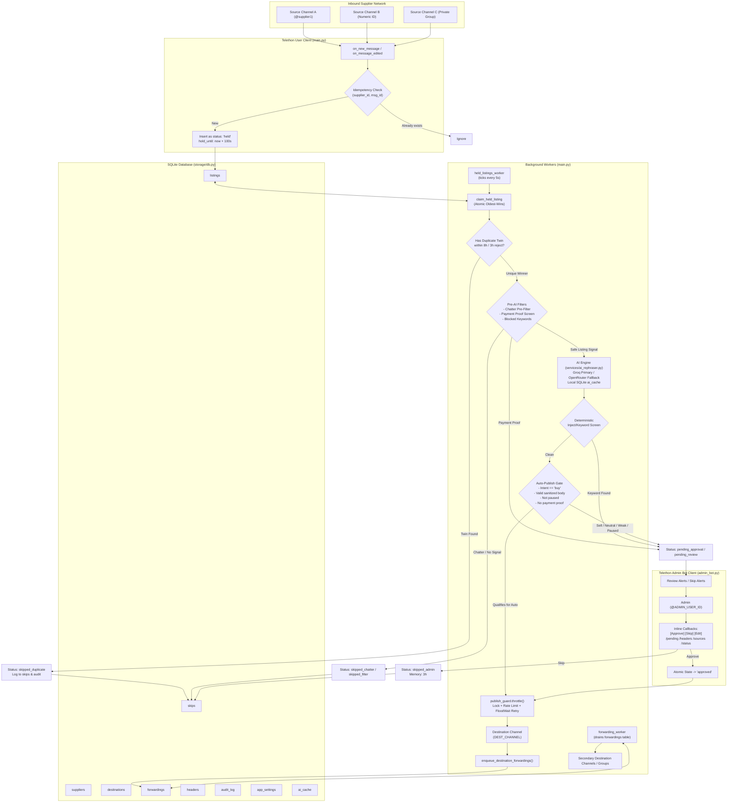
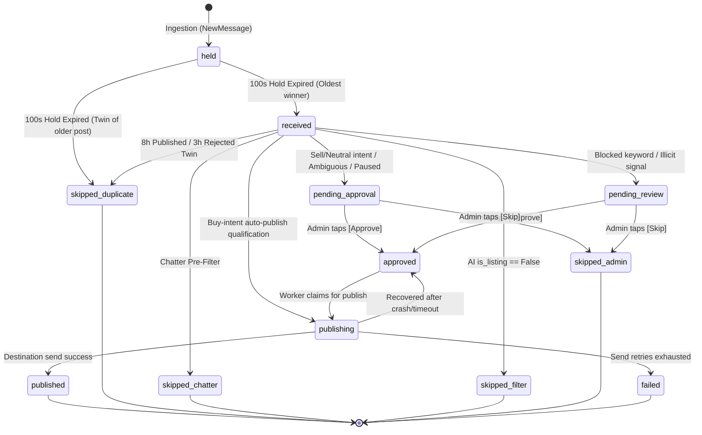

# Telegram Channel Monitor & Auto-Republisher: Architecture & Codebase Guide

> **Audience:** AI Agents, LLM assistants, and Software Engineers.  
> **Purpose:** Authoritative, comprehensive architectural blueprint, component map, and end-to-end data flow guide for the Telegram Channel Monitor & Auto-Republisher. Read this document to understand the codebase structure, invariants, state machine, and processing pipeline without needing to read every source file.

---

## 1. Executive Summary & Core Mission

### 1.1 What This System Does
This application is a **resilience-focused, asynchronous Telegram monitoring and republishing engine**. It continuously monitors a network of digital product reseller channels (suppliers), extracts listings (such as streaming subscriptions, crypto accounts, neobanks, cloud VPS, and KYC verification accounts), cleans and reformats them using an AI engine (Groq/OpenRouter with deterministic fallbacks), and republishes them to a target channel (`DEST_CHANNEL`) with optional forwarding to secondary target channels or groups.

### 1.2 Target Business Domain
The monitored marketplace exchanges legitimate digital accounts, subscriptions, and KYC-verified profiles:
- **Streaming & Subscriptions:** Netflix, Spotify, YouTube Premium, Disney+, Hulu, Apple TV, IPTV, Prime Video.
- **Crypto Platforms:** Bybit, Binance, KuCoin, OKX, Crypto.com, Coinbase, Kraken, Bitget.
- **Financial & Neobanks:** Revolut, Wise, Buddybank, Indexo, PayPal, Stripe, Payoneer, Skrill, Neteller, N26, CashApp.
- **Cloud & Infrastructure:** Hetzner, AWS, DigitalOcean, OVH, ChatGPT / OpenAI.

### 1.3 Dual Client Architecture
The system uses **Telethon (MTProto)** under two distinct personas:
1. **User Client (`monitor_session.session`):** A regular Telegram user account that can join and listen to restricted channels, monitor public/private supplier feeds, read messages, and publish clean posts to destination channels or forward to groups.
2. **Admin Bot Client (`admin_bot_session.session`):** A Telegram Bot (`BOT_TOKEN`) interacting solely with `ADMIN_USER_ID`. It serves as the mobile control room, offering inline interactive keyboards for manual listing reviews, editing, status inspection, channel management, and custom emoji header configuration.

---

## 2. Hard Invariants & Non-Negotiable Rules

The codebase has evolved through strict production audits. Any agent or developer modifying the system **must strictly uphold these invariants**:

1. **Buyer-Only Framing (The Channel is ALWAYS the Buyer):**
   - The destination channel posts exclusively as a buyer (`WTB` / "Want To Buy").
   - Seller-oriented phrasing (`WTS`, `Selling`, `For Sale`, `Stock available`, `@supplier_handle`) must **never** leak into published titles, headers, or content.
2. **Static Price DM Policy (Prices Never Render):**
   - Published posts **never display numbers, prices, markup, or currency amounts**.
   - Every published post concludes with the static footer:
     ```text
     ──────────
     🤑 Price  DM
     📞 Contact : @CONTACT_USERNAME
     ```
   - Pricing is negotiated privately in direct messages. The pricing calculations and markups from older schemas were intentionally deleted (schema v9).
3. **Payment Proofs are NEVER Auto-Published:**
   - Any message showing receipts, payment screenshots, transaction hashes, "I paid $X", or "transfer completed" is never auto-published; routed to admin review (admin may approve).
4. **Prompt Injection & Illicit Content Defense:**
   - Hacked, cracked, stolen, combolist, dump, or carded assets are never auto-published; routed to admin review.
   - Deterministic keyword safety screens (`filters.contains_blocked_keyword`) execute **both before and after** the AI. Even if a prompt-injected message convinces the AI model to output `blocked: false`, the deterministic filter overrides it and routes it to `pending_review` (admin may approve).
5. **Exact UTF-16 Entity Offsets for Custom Emoji:**
   - Telegram MTProto calculates entity offsets and lengths in **UTF-16 code units**, not Python character indices or byte counts.
   - All offsets and lengths are computed using `_utf16_len(s) = len(s.encode('utf-16-le')) // 2`.
   - Every `MessageEntityCustomEmoji` must wrap the exact single emoji glyph specified by that custom emoji's `alt` attribute. Placeholders (such as spaces or bullets) cause Telegram to fail rendering the custom emoji.
6. **No Duplicate Country Flags:**
   - If a country flag is appended to a body line, that country is marked as `covered`. The extras line builder will never re-emit flags for covered countries, preventing duplicates like `"NO POLAND / POLAND 🇵🇱"`.
7. **Single Source of Truth for Suppliers:**
   - `SOURCE_CHANNELS` in `.env` is read **only once** on an empty database (first setup). Subsequent management is handled exclusively via the database and Admin Bot (`/sources`, `/addsupplier`).
8. **Configurable Quarantine Hold & Instant Low-Latency Fast Mode:**
   - Incoming messages are initially placed in status `held`.
   - In fast mode (`QUARANTINE_SECONDS=0`, default), `hold_until` is set to the present/past, making the listing immediately due (<1ms) upon arrival. An event-driven trigger (`wake_held_worker()`) wakes the held worker immediately without polling delay.
   - For burst deduplication buffers, `QUARANTINE_SECONDS` can be configured > 0 (e.g. 100s). The atomic claim `claim_held_listing` enforces duplicate suppression regardless of delay mode.
9. **Atomic Claims and Rate Limiting:**
   - Publishing to the destination channel is guarded by `publish_guard.throttle()` (1 lock + `PUBLISH_INTERVAL`, defaulting to 0.5s).
   - Database operations use atomic state claims (`claim_held_listing`, `claim_listing_for_publish`) to prevent race conditions between automatic workers and admin taps.

---

## 3. High-Level Architecture & End-to-End Flow

### 3.1 Architecture Diagram



---

## 4. Codebase Organization & Directory Structure

The codebase uses a modular architecture with clean separation of concerns, while retaining backward-compatibility facades at the repository root.

```text
api tele/
├── core/                         # Core infrastructure & configuration
│   ├── config.py                 # Environment parsing helpers (get_required_env, get_int_env, get_bool_env)
│   ├── runtime.py                # Process health, heartbeats, stuck worker alarms, metrics
│   └── texts.py                  # UI texts, notification templates, command help strings
│
├── domain/                       # Domain data structures & business models
│   ├── models.py                 # Strongly-typed dataclasses (ListingItem, SupplierItem, DestinationItem, HeaderItem, ForwardItem, SkipItem)
│   └── countries.py              # Canonical country catalog, custom emoji document IDs, alt glyphs, flag injection
│
├── pipeline/                     # Processing pipeline, sanitization & formatting
│   ├── filters.py                # Pre-AI filters, chatter detection, payment proof screens, blocked keywords, deduplication
│   ├── parser.py                 # Telegram post shell construction, UTF-16 entity calculations, emoji stripping, price regex
│   └── rules.py                  # ListingPipeline decision gates (can_auto_publish, can_fallback_publish)
│
├── services/                     # External services & business logic
│   ├── ai_rephraser.py           # Groq API client, OpenRouter fallback, prompt definitions, JSON repair, cache layer
│   ├── fsm.py                    # PersistentDict (SQLite-backed session state for admin wizards)
│   └── publish_guard.py          # Destination rate limiter, single lock, FloodWait retry wrapper, destination verification
│
├── storage/                      # SQLite persistence & data access layer
│   ├── db.py                     # Primary storage facade re-exporting all repositories
│   └── repositories/
│       ├── base.py               # db_session, connection lifecycle, WAL pragma, schema versioning & migrations
│       ├── listings.py           # Listings CRUD, 100s quarantine claims, duplicate detection, publish claims
│       ├── suppliers.py          # Supplier channel CRUD, deduplication, resolution, membership tracking
│       ├── destinations.py       # Destination targets CRUD, health checking, forwarding queue
│       ├── headers.py            # Custom emoji header pool CRUD, sticky random header resolution
│       └── audit.py              # Audit logs, skips tracking, app_settings key-value store, AI cache, retention purge
│
├── admin_bot.py                  # Personal Admin Control Center bot (Telethon client, commands, inline callbacks, wizards)
├── main.py                       # Main orchestrator (user client, event listeners, background workers, lifecycle)
├── test_system.py                # Comprehensive test suite (~230+ unit tests covering all components)
│
├── [Backward-Compatibility Root Facades]
│   ├── ai_rephraser.py -> services.ai_rephraser
│   ├── countries.py    -> domain.countries
│   ├── db.py           -> storage.db
│   ├── filters.py      -> pipeline.filters
│   ├── models.py       -> domain.models
│   ├── parser.py       -> pipeline.parser
│   ├── publish_guard.py-> services.publish_guard
│   └── texts.py        -> core.texts
│
├── .env.example                  # Environment configuration template
├── requirements.txt              # Project Python dependencies
├── run.ps1                       # Windows local start script
└── .github/workflows/deploy.yml  # Automated deployment workflow to AWS EC2
```

---

## 5. Detailed Component Breakdown

### 5.1 Orchestration Layer (`main.py`)
- **Lifecycle & Setup (`main()`):**
  1. Validates configuration variables (`API_ID`, `API_HASH`, `DEST_CHANNEL`, `BOT_TOKEN`, `ADMIN_USER_ID`).
  2. Runs `db.init_db()` to initialize tables, WAL mode, foreign keys, and run pending migrations up to current version (v12).
  3. Executes `db.ensure_env_seed(SOURCE_CHANNELS)` (only if the supplier table is completely empty).
  4. Initializes the AI engine (`ai_rephraser.init_groq()`).
  5. Connects the Telethon user client (`client`) and optionally starts the admin bot client (`bot_client`).
  6. Registers Telegram event handlers:
     - `events.NewMessage` on monitored supplier channels.
     - `events.MessageEdited` to propagate source edits to published posts.
     - `events.MessageDeleted` to log audit records.
  7. Spawns asynchronous background workers:
     - `held_listings_worker`: Periodically claims and evaluates messages whose 100s quarantine expired.
     - `approved_listings_worker`: Drains manual approvals and publishes them.
     - `forwarding_worker`: Forwards published channel posts to secondary destinations.
     - `supplier_resolution_worker`: Resolves usernames/IDs into Telethon entity references.
     - `health_check_worker`: Emits operational metrics and worker heartbeats.
     - `retention_worker`: Prunes expired listings, skips, audit logs, and cache entries past `RETENTION_HOURS`.
     - `rephrase_unpublished`: Startup sweep that passes any unprocessed fallback drafts through the AI.
  8. Manages the connection lifecycle with an auto-reconnect backoff loop and clean shutdown handling.
- **Manual Mode (`--manual`):**
  - Starts Telethon user client and admin bot without registering ingestion listeners or auto-publishing workers.

### 5.2 Storage & Repositories (`storage/` & `db.py`)
- **`storage.repositories.base`:**
  - Manages SQLite connection via `db_session()` context manager.
  - Enables `PRAGMA journal_mode=WAL`, `PRAGMA synchronous=NORMAL`, and `PRAGMA foreign_keys=ON`.
  - Transaction retry wrapper `_commit_with_retry()` automatically retries SQLite busy/locked errors with exponential jitter.
  - Implements sequential, idempotent database migrations:
    - `v8`: Schema base and cleanups.
    - `v9`: Total removal of price markup columns.
    - `v10`: Adding indexes and cleanups.
    - `v11`: 100s Quarantine hold (`listings.hold_until`, `listings.duplicate_of`, index `idx_listings_hold`).
    - `v12`: Admin-managed custom-emoji headers (`headers` table, `listings.header_id`).
    - `v13`: Ingest crash recovery (`listings.received_at`, index `idx_listings_received_at`) and persistent post sequence (`app_settings.post_counter`).
- **`storage.repositories.listings`:**
  - `insert_listing(...)`: Creates a listing record with status `held` and `hold_until = now + 100s`.
  - `claim_held_listing(...)`: Atomically queries `listings` for expired held records, groups duplicates by fingerprint, selects the oldest row as the winner, marks duplicate twins as `skipped_duplicate`, and transitions the winner to `received`.
  - `claim_listing_for_publish(...)`: Atomically transitions an approved/auto listing to `publishing` with a twin check, ensuring that two concurrent workers cannot publish identical listings.
  - `find_recent_similar_listing(...)`: Fingerprint match within `DEDUP_HOURS` (8 hours) for published/active listings, and within `REJECT_MEMORY_MINUTES` (3 hours) for admin-rejected listings.
- **`storage.repositories.headers`:**
  - `headers` table stores `emoji_json` representing `[{alt, document_id}]`.
  - `resolve_header_for_listing(listing_id)`: Implements **random-but-sticky** selection. On the first call, it picks a random header from the pool, writes it to `listings.header_id`, and permanently locks it to that listing. Previews and final publications share the exact same header.
- **`storage.repositories.destinations`:**
  - Manages secondary target channels/groups.
  - `queue_forwarding(...)`: Adds forward jobs to the `forwardings` table for every active destination when a post lands on `DEST_CHANNEL`.
- **`storage.repositories.audit`:**
  - `audit_log`: Permanent audit trail of automated and manual decisions (`published_auto`, `published_approved`, `edit_rejected_review`, `category_blocked_review`, etc.), purged past `AUDIT_RETENTION_DAYS` (default 30).
  - `skips`: Records every skipped listing and its specific reason.
  - `ai_cache`: Caches model responses by normalized text fingerprint for `AI_CACHE_TTL_HOURS`.
  - `purge_expired_data(...)`: Runs rolling window cleanup deleting items older than `RETENTION_HOURS` in FK-safe child-to-parent order (`blocklist_hits`, `forwardings`, `skips`, `audit_log`, `listings`, `ai_cache`). Active/in-flight listings in `publishing`, `held`, `received`, `pending_*`, and `approved` are strictly protected and never purged.

### 5.3 Admin Control Bot (`admin_bot.py`)
- Provides a mobile Telegram control center for `ADMIN_USER_ID`:
  - **Inline Approval Cards:** Sent for ambiguous listings with `[Approve]`, `[Skip]`, and `[Edit]` buttons.
  - **Listing Editor Wizard:** Multi-step interactive flow to modify platform name or body text before approving. State is persisted in SQLite via `PersistentDict` to survive bot restarts.
  - **Header Capture Flow (`/headers`):**
    - The admin adds headers by sending a message with exactly 3 Telegram custom emojis.
    - The bot validates the custom emoji count, verifies that no other text or links exist, extracts the `document_id` and `alt`, and persists it to the header pool.
  - **Channel Management (`/sources`, `/destinations`, `/setchannel`):**
    - Dynamic channel addition via `@username`, numeric ID, or by forwarding a message from a private channel or group.
  - **System Telemetry & Controls:**
    - `/status`: Operational dashboard displaying processed counts, published listings, skip reasons, worker health, and uptime.
    - `/pending`: Browse and paginated review of pending listings.
    - `/skipped`: Browse dropped listings with one-tap re-review (`reskip:`).
    - `/published`: Feed of recently published posts with direct links.
    - `⏸ All Stop` / `▶ All Start`: Toggles automatic publishing while keeping manual review and approvals active.
    - `💤 I'm Asleep` / `☀️ I'm Awake`: Toggles an away-mode footer on newly published posts.

### 5.4 AI Analysis Engine (`services/ai_rephraser.py`)
- **Model Providers:**
  - Primary: **Groq** (`qwen/qwen3.8-27b` or configured `GROQ_MODEL`). Fast inference, low latency.
  - Secondary / Free Fallback: **OpenRouter** (`openai/gpt-oss-120b:free` or configured `OPENROUTER_MODEL`). Circuit-breaker cooldown prevents quota exhaustion during Groq outages.
- **Single-Shot Prompting (`ANALYZE_PROMPT`):**
  - Untrusted supplier text is strictly wrapped in `<supplier_message>` tags to defend against prompt injection.
  - The model outputs a strict JSON payload:
    ```json
    {
      "is_listing": true,
      "blocked": false,
      "block_reason": "",
      "platform": "netflix",
      "intent": "buy",
      "dm_request": true,
      "content": [
        "Netflix Premium 4K UHD",
        "1 Month Subscription",
        "Private Account with Warranty"
      ],
      "price": null
    }
    ```
- **Content Rewriting Rules:**
  - The body lines must be factual, simple, and stripped of marketing hype.
  - Line 1 must begin with the platform/service name.
  - Prices, budget numbers, seller contact handles, and external links are strictly forbidden in `content` lines.

### 5.5 Pipeline Formatting & Custom Emojis (`pipeline/parser.py` & `domain/countries.py`)
- **`build_ai_message(...)` Post Structure:**
  ```text
  #12                               <-- Sequential Post Number (Optional)
  💎⭐🔥                             <-- Sticky Custom Emoji Header (3 custom emoji glyphs)
  NETFLIX                           <-- Uppercase Platform Banner
                                    <-- Blank Line
  Netflix Premium 4K UHD            <-- Cleaned Body Line
  1 Month Subscription  🇺🇸          <-- Body Line with Appended Country Flag (if detected)
  ──────────                        <-- Divider Line
  🤑 Price  DM                      <-- Static Price DM Indicator
  📞 Contact : @CONTACT_USERNAME    <-- Buyer Contact Handle
  [💤 Buyer currently away...]      <-- Optional Asleep Footer
  ```
- **Country Flag System (`domain/countries.py`):**
  - Contains a pre-compiled mapping (`COUNTRY_EMOJI`) of canonical country names to custom emoji document IDs.
  - `_FLAG_ALTS` maps each country to its exact native emoji flag (e.g. `🇺🇸`, `🇬🇧`, `🇩🇪`).
  - `flag_body_lines()` detects country mentions in body text and appends `"  <flag>"` with exact UTF-16 entity anchors.
  - Tracks all matched countries in a `covered` set. Uncovered countries detected in the raw message are appended as extra lines at the bottom.

---

## 6. End-to-End Processing Lifecycle: Step-by-Step

Here is the exact progression of a supplier message through the system:

```text
[ Supplier Channel Message ]
             │
             ▼
1. INGESTION & IDEMPOTENCY
   ├── Event received via Telethon NewMessage listener.
   ├── Check (supplier_id, source_message_id) in database.
   │   └── If already recorded -> Drop immediately (ignore duplicates).
   └── Insert into `listings` table:
       ├── status = 'held'
       └── hold_until = datetime.utcnow() + 100 seconds
             │
             ▼
2. 100-SECOND QUARANTINE HOLD
   ├── Message waits in SQLite.
   └── Gives time for identical re-posts across supplier networks to arrive.
             │
             ▼
3. BATCH CLAIM & EVALUATION (`held_listings_worker`)
   ├── Worker polls `listings` for rows where status == 'held' AND hold_until <= now.
   ├── `claim_held_listing()` groups rows by normalized text + price fingerprint.
   │   ├── Oldest row -> Promoted to status 'received' (evaluation winner).
   │   └── Newer rows -> Marked status 'skipped_duplicate' (duplicate_of = winner.id).
   └── If winner matches a listing published within 8h or rejected within 3h:
       └── Marked 'skipped_duplicate', alert sent to admin, pipeline ends.
             │
             ▼
4. PRE-AI SAFETY SCREENS
   ├── Chatter Pre-Filter: Obvious rules, welcome pins, or non-listings -> status 'skipped_chatter'.
   ├── Blocked Keywords Screen: Hacked/cracked/stolen keywords -> status 'pending_review'.
   └── Payment Proof Screen: Transfer receipts, confirmations -> status 'pending_approval'.
             │
             ▼
5. AI ANALYSIS (`services/ai_rephraser.py`)
   ├── Query SQLite `ai_cache` by fingerprint.
   │   └── If hit: Return cached analysis dict.
   ├── If miss: Invoke Groq API (fallback to OpenRouter on timeout or rate-limit).
   └── Cache successful response.
             │
             ▼
6. POST-AI VALIDATION & INJECTION DEFENSE
   ├── Check `filters.contains_blocked_keyword(raw_text)` again.
   │   └── If blocked: Force status 'pending_review' regardless of AI response.
   ├── If `is_listing == False`:
   │   └── Mark status 'skipped_filter', send skip alert to admin.
   └── Sanitize AI body lines:
       └── Strip stray prices, currencies, usernames, and empty lines.
             │
             ▼
7. DECISION GATING
   ├── Buy-Intent Auto-Publish Gate:
   │   ├── (intent == 'buy') AND (not system_paused) AND (body_ok) AND (no payment proof)
   │   └── IF TRUE: Proceed directly to Step 8 (Auto-Publish).
   └── Manual Review Route:
       ├── All sell listings, neutral intent, unconfident extractions, or paused system.
       ├── Set status 'pending_approval' or 'pending_review'.
       ├── Send interactive card with preview and buttons to Admin Bot.
       └── On admin [Approve] click -> Set status 'approved' -> Proceed to Step 8.
             │
             ▼
8. POST RENDERING & ENTITY GENERATION
   ├── Assign or fetch sticky custom-emoji header (`resolve_header_for_listing`).
   ├── Fetch sequential post number (`db.next_post_number()`).
   ├── Match and append country flags (`flag_body_lines`).
   └── Build text and UTF-16 `MessageEntityCustomEmoji` entities via `parser.build_ai_message()`.
             │
             ▼
9. DESTINATION PUBLICATION (`publish_guard`)
   ├── Acquire `publish_guard` rate-limiting lock (enforces `PUBLISH_INTERVAL`).
   ├── Execute `client.send_message(DEST_CHANNEL, text, formatting_entities=entities)`.
   │   └── Catch `FloodWaitError`: Sleep requested seconds, retry within budget.
   ├── Update listing: status = 'published', published_message_id = msg.id.
   ├── Send success alert to Admin Bot.
   └── Record event in `audit_log`.
             │
             ▼
10. DESTINATION FORWARDING QUEUE
    ├── `enqueue_destination_forwardings()` queues rows in `forwardings` table.
    └── `forwarding_worker` sequentially forwards published message to secondary targets.
```

---

## 7. Database Architecture & State Machine

### 7.1 Key Tables Overview

| Table Name | Primary Role | Key Columns |
|---|---|---|
| `listings` | Primary lifecycle table for every inbound listing | `id`, `supplier_id`, `source_message_id`, `status`, `raw_text`, `clean_text`, `platform_name`, `intent`, `fingerprint`, `hold_until`, `duplicate_of`, `header_id`, `published_message_id`, `post_number`, `created_at` |
| `suppliers` | Monitored channels and source chats | `id`, `channel_username`, `channel_id`, `display_name`, `active`, `added_at` |
| `destinations` | Forwarding target channels and groups | `id`, `chat_id`, `title`, `active`, `created_at` |
| `forwardings` | Asynchronous queue for destination forwards | `id`, `listing_id`, `published_chat_id`, `published_message_id`, `destination_id`, `status`, `retry_count`, `retry_at` |
| `headers` | Pool of admin-managed custom-emoji banners | `id`, `text`, `emoji_json`, `created_at` |
| `skips` | Granular log of dropped listings for digest / audit | `id`, `supplier_id`, `message_id`, `reason`, `raw_text`, `timestamp` |
| `audit_log` | Immutable record of system and admin actions | `id`, `listing_id`, `action`, `details`, `timestamp` |
| `ai_cache` | SHA1 fingerprint cache for LLM analysis results | `fingerprint`, `analysis_json`, `created_at` |
| `app_settings`| Key-value store for runtime flags & wizard FSM | `key`, `value` |

### 7.2 Listing State Machine



### 7.3 Listing Status Definitions

| Status | Exact Meaning | Transition Triggers |
|---|---|---|
| `held` | Parked in 100s dedup quarantine on arrival | Set on message ingest; waits for `hold_until` |
| `received` | Promoted winner from quarantine, ready for evaluation | `claim_held_listing` won; or stale crash recovery claim |
| `pending_review` | Risk-flagged listing requiring human review | Payment proof, blocked keyword, prompt injection, or blocked platform category |
| `pending_approval` | Ambiguous listing requiring human approval | Sell or neutral intent, system paused, weak body, AI failure/unavailable, fallback preview |
| `approved` | Approved by admin, queued for publishing | Admin clicks `[Approve]` or applies edit |
| `publishing` | Atomically claimed by worker for active publication | `claim_listing_for_publish` won |
| `published` | Successfully posted to destination channel | `client.send_message` / `edit_message` completed |
| `skipped_duplicate` | Twin identical listing dropped | Quarantine batch claim or 8h/3h dedup match |
| `skipped_chatter` | Rule/welcome/non-listing chatter dropped | Chatter pre-filter matched |
| `skipped_filter` | Non-listing content dropped | AI classified `is_listing == False` |
| `skipped_admin` | Manually rejected by administrator | Admin clicks `[Skip]` on review card (3h reject memory) |
| `failed` | Destination publishing failed after max retries | Rate limit or connection retries exhausted |
| `sold` | Item marked sold out | Admin marks sold (`/sold` or inline button) |

---

## 8. Critical Subsystems Deep Dive

### 8.1 Telegram Entity Calculations (UTF-16 Matching)
Telegram MTProto message entities (bold, links, custom emoji) require offset and length measured in **UTF-16 code units**:
- Standard ASCII characters: 1 code unit.
- Astral Plane characters (most emojis, e.g. 🔥, 🤑, 📞): 2 code units (surrogate pairs).
- Flag emoji (regional indicator pairs, e.g. 🇺🇸 = `U+1F1FA U+1F1F8`): 4 code units.
- Subdivision flags (e.g. Scotland 🏴󠁧󠁢󠁳󠁣󠁴󠁿): up to 14 code units.

**Implementation in `pipeline/parser.py`:**
```python
def _utf16_len(s: str) -> int:
    """Length of string in UTF-16 code units (Telegram offset standard)."""
    return len(s.encode("utf-16-le")) // 2

def _make_custom_emoji_entity(offset: int, document_id: int, placeholder: str):
    length = len(placeholder.encode("utf-16-le")) // 2
    return MessageEntityCustomEmoji(
        offset=offset,
        length=length,
        document_id=document_id,
    )
```
Whenever constructing entities, `offset` must be tracked by summing `_utf16_len(preceding_text)`. Never use Python `len(string)`.

### 8.2 Sticky Header Resolution
Custom emoji headers are managed exclusively via `/headers` in the Admin Bot:
1. When a post is prepared for preview or publishing, `resolve_header_for_listing(listing_id)` is invoked.
2. If `listing.header_id` is already assigned, it reuses that exact header.
3. If unassigned, it selects a random header from the `headers` table and saves `header_id` to `listings`.
4. The preview shown to the admin is **byte-for-byte identical** to what is published to the channel.

### 8.3 FSM & Wizard Persistence (`services/fsm.py`)
Multi-step interactive dialogues (such as editing a listing before publishing, or capturing 3 custom emojis) use `PersistentDict`:
- Extends Python `dict`.
- Intercepts `__setitem__`, `__delitem__`, `pop()`, and `clear()`.
- Automatically syncs state changes to SQLite `app_settings` under a prefix (e.g. `wizard:`).
- If the bot process crashes or restarts while an admin is halfway through editing a listing, the draft state is preserved.

---

## 9. Configuration & Environment Variables

Key parameters in `.env`:

| Variable | Default | Purpose & Description |
|---|---|---|
| `API_ID` | *Required* | Telegram API ID from `my.telegram.org` |
| `API_HASH` | *Required* | Telegram API Hash from `my.telegram.org` |
| `DEST_CHANNEL` | *Required* | Primary destination channel username (`@channel`) or numeric ID |
| `BOT_TOKEN` | *Required* | Telegram Bot token from `@BotFather` for Admin Bot |
| `ADMIN_USER_ID` | *Required* | Numeric Telegram user ID of authorized administrator |
| `CONTACT_USERNAME` | *Required* | Public contact handle appended to every published post footer |
| `SOURCE_CHANNELS` | `""` | Optional initial comma-separated supplier channels (read **only once** on empty DB) |
| `GROQ_API_KEY` | `""` | API key for Groq LLM inference |
| `GROQ_MODEL` | `qwen/qwen3.8-27b` | Primary Groq model name (verified against Groq model-list at startup) |
| `GROQ_TEMPERATURE` | `0.1` | Inference temperature (clamped strictly between `0.0` and `0.3`) |
| `OPENROUTER_API_KEY` | `""` | Fallback API key for OpenRouter free models |
| `OPENROUTER_MODEL` | `openai/gpt-oss-120b:free` | Fallback model name on OpenRouter |
| `FALLBACK_AUTOPUBLISH`| `0` | If 1, allow deterministic fallback auto-publish only when all buy/platform criteria pass |
| `BLOCKED_PLATFORM_CATEGORIES` | `""` | Comma-separated categories (e.g. `kyc,neobank,exchange`) routed to `pending_review` |
| `QUARANTINE_SECONDS` | `0` | Ingestion quarantine duration before evaluation (`0` for instant processing; >0 for burst hold) |
| `DEDUP_HOURS` | `8` | Rolling window for duplicate detection on published listings |
| `DEDUP_IGNORE_PRICE` | `1` | If 1, fingerprint strips price tokens so identical products with different prices match |
| `REJECT_MEMORY_MINUTES`| `180` | Duration that an admin-rejected listing blocks identical re-posts (3 hours) |
| `RETENTION_HOURS` | `24` | Rolling retention for listings/forwardings; must satisfy `RETENTION_HOURS >= DEDUP_HOURS + 2` |
| `AUDIT_RETENTION_DAYS`| `30` | Rolling retention window for permanent `audit_log` entries |
| `PUBLISH_INTERVAL` | `0.5` | Minimum seconds between consecutive destination channel posts |
| `PUBLISH_MAX_RETRIES` | `4` | Max attempts before marking a publish attempt as failed |
| `FORWARD_WORKER_INTERVAL`| `0.5` | Polling fallback for destination forwarding worker |
| `FORWARD_PACING_SECONDS` | `1.0` | Pacing delay between forwarding to each destination channel |
| `PRE_FILTER_CHATTER` | `1` | Enable rule/welcome chatter pre-filtering before invoking AI |
| `DETERMINISTIC_FALLBACK`| `1` | Enable rule-based draft preview when AI services are unreachable |
| `DB_PATH` | `monitor.db` | SQLite database file location |

---

## 10. Operations, Deployment & Runbook

### 10.1 Local Execution
```powershell
# 1. Activate virtual environment
.\venv\Scripts\Activate.ps1

# 2. Run test suite
python -m unittest test_system

# 3. Launch application
python main.py
# Or launch admin bot only (without ingestion):
python main.py --manual
```
*First run note:* Telethon will prompt in the terminal for your phone number and login code to create `monitor_session.session`.

### 10.2 Production Deployment (AWS EC2)
The repository contains `.github/workflows/deploy.yml` which triggers on push to `main`:
1. Connects via SSH to AWS EC2 instance.
2. Executes `git fetch origin main && git reset --hard origin/main`.
3. Installs updated dependencies into `venv`.
4. Restarts the systemd daemon:
   ```bash
   sudo systemctl restart tele-monitor
   sudo systemctl status tele-monitor --no-pager
   ```
5. Rotating log output is written to `monitor.log` (5MB maximum size, 5 backup rotations).

---

## 11. Agent Guidelines: Dos and Don'ts

When editing or extending this codebase, adhere to these rules:

### DO:
- **Run tests before and after changes:** Always verify with `python -m unittest test_system`.
- **Use `storage/db.py` / repository methods:** Do not execute raw, unparameterized SQL queries in pipeline or bot files.
- **Compute offsets with `_utf16_len`:** Any custom emoji or formatting entity added must have its offset verified in UTF-16 code units.
- **Use `db.run_async` for database calls in async handlers:** SQLite calls are synchronous; offload them to worker threads to avoid blocking the asyncio event loop.
- **Preserve FloodWait handling:** Wrap interactive Telegram actions with `publish_guard.run_with_floodwait_retry()`.

### DO NOT:
- **NEVER re-introduce prices to published posts:** Published posts must strictly end with `Price  DM`.
- **NEVER auto-publish payment receipts or proof messages:** These must always be flagged for review.
- **NEVER use Python `len()` for Telegram entity offsets:** Always use `_utf16_len()`.
- **NEVER re-read `SOURCE_CHANNELS` from `.env` after initial startup:** Manage channels dynamically via `db` and `/sources`.
- **NEVER delete `listings` rows arbitrarily:** Maintain foreign key constraints and rely on `purge_expired_retention_data()`.
