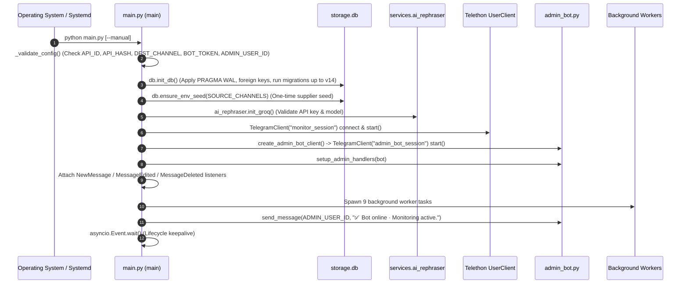
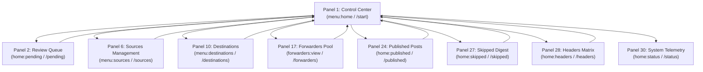
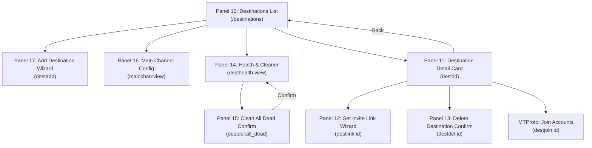
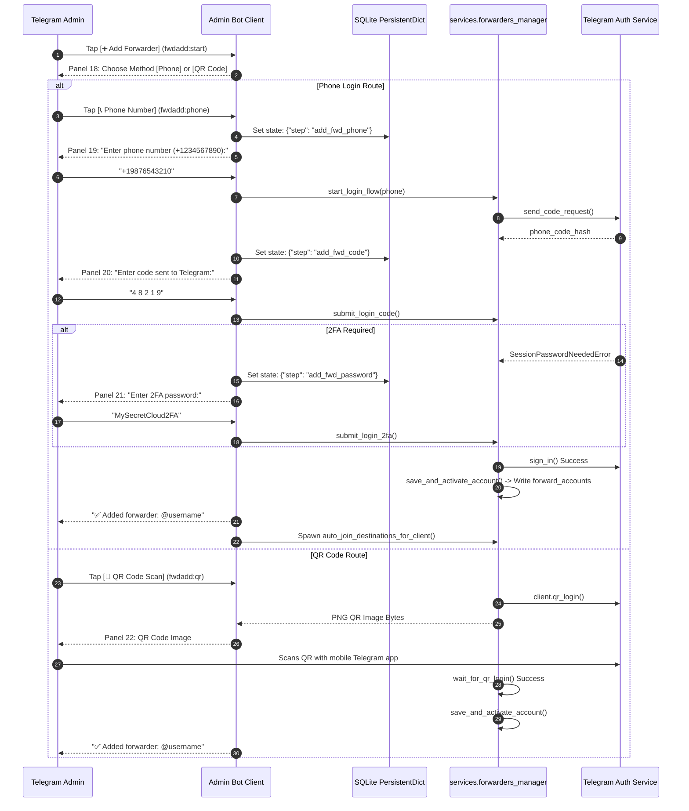
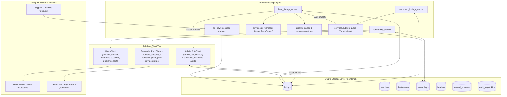

# TELEGRAM CHANNEL MONITOR & AUTO-REPUBLISHER
## Complete Codebase Audit, Interface Blueprint & Application Flow Documentation

> **Document Type:** Technical Architecture Specification, Reverse-Engineering Audit & Navigation Blueprint  
> **Target Audience:** Senior Software Engineers, Systems Architects, and Autonomous Coding Agents  
> **Codebase Target:** Telegram Channel Monitor & Auto-Republisher (Production v14 Schema)  
> **Repository Root:** `c:\Users\AIDI\Documents\api tele` (Windows Dev) / `/home/ubuntu/tele-monitor` (Ubuntu Linux Prod)  
> **Audit Status:** Verified against 100% of codebase modules, 112 inline button definitions, 6 persistent reply buttons, 58 callback routes, 11 database tables, and 331 automated test specifications.

---

## Table of Contents
1. [Project Overview](#1-project-overview)
2. [Technology Stack](#2-technology-stack)
3. [Project Directory Structure](#3-project-directory-structure)
4. [Application Entry Point and Initialization](#4-application-entry-point-and-initialization)
5. [High-Level System Architecture](#5-high-level-system-architecture)
6. [Telegram Interface Overview](#6-telegram-interface-overview)
7. [Main Menu Structure](#7-main-menu-structure)
8. [Complete Panel Inventory](#8-complete-panel-inventory)
9. [Detailed Button Documentation](#9-detailed-button-documentation)
10. [Callback Data and Handler Mapping](#10-callback-data-and-handler-mapping)
11. [Complete Navigation Flow](#11-complete-navigation-flow)
12. [Mermaid Application Flow Diagrams](#12-mermaid-application-flow-diagrams)
13. [Detailed User Journey Workflows](#13-detailed-user-journey-workflows)
14. [Database Architecture and Operations](#14-database-architecture-and-operations)
15. [External APIs and Integrations](#15-external-apis-and-integrations)
16. [User Roles and Permissions](#16-user-roles-and-permissions)
17. [State and Session Management](#17-state-and-session-management)
18. [Error Handling and Exceptional Workflows](#18-error-handling-and-exceptional-workflows)
19. [Background Tasks and Scheduled Jobs](#19-background-tasks-and-scheduled-jobs)
20. [Code Dependencies and Module Relationships](#20-code-dependencies-and-module-relationships)
21. [Identified Bugs and Navigation Issues](#21-identified-bugs-and-navigation-issues)
22. [Dead Code and Unused Components](#22-dead-code-and-unused-components)
23. [Technical Observations and Recommendations](#23-technical-observations-and-recommendations)
24. [Glossary of Important Functions and Terms](#24-glossary-of-important-functions-and-terms)

---

## 1. Project Overview

The **Telegram Channel Monitor & Auto-Republisher** is an asynchronous, high-resilience Telegram ingestion, sanitization, rephrasing, and multi-target distribution system.

### Core Mission
1. **Continuous Supplier Ingestion:** Monitors an arbitrary network of upstream supplier channels and groups (digital accounts, streaming subscriptions, crypto exchange accounts, neobanks, VPS, and cloud resources).
2. **Deterministic & LLM Intelligence Pipeline:** Ingests untrusted supplier copy, isolates potential prompt injection attacks, detects chatter, screens payment proofs and blocked keywords, re-formats content through Groq (primary) or OpenRouter (fallback) LLM models into clean, standardized post bodies.
3. **Strict Buyer Persona ("WTB" Only):** Converts seller marketing language (`WTS`, `Selling`, stock lists, supplier usernames) into buyer-framed requests (`WTB` / "Want To Buy"). Prices are permanently stripped and replaced by an authoritative `Price DM` footer with the operator's designated contact handle (`@CONTACT_USERNAME`).
4. **Custom-Emoji Visual Shells:** Renders native Telegram custom emoji headers (spelling `WTB` with 3 custom glyphs) and automatically appends country flags anchored by exact UTF-16 entity offsets.
5. **Multi-Target Distribution & Cascading Forwarding:** Publishes the master listing to a primary destination channel (`DEST_CHANNEL`), then fans out delivery through a pool of authenticated forwarder accounts to secondary channels and groups. If a forwarder account hits rate limits or is banned, secondary forwarders automatically take over via cascading failover.
6. **Mobile Admin Mission Control:** Provides a private control center for `ADMIN_USER_ID` inside Telegram via an interactive Telegram Bot. The administrator reviews ambiguous listings, modifies text via interactive wizards, manages supplier sources and destination targets, inspects system telemetry, captures custom emoji headers, and authorizes forwarder phone logins.

---

## 2. Technology Stack

| Layer | Technology | Details / Version |
|---|---|---|
| **Language Runtime** | Python | 3.14 (strict async/await, dataclasses, typing) |
| **Telegram MTProto Framework** | Telethon | 1.44+ (Layer 227 MTProto schema, custom entities, userbot + bot clients) |
| **Database Engine** | SQLite3 | Native WAL mode (`PRAGMA journal_mode=WAL`), foreign keys enforced, busy timeout 15s |
| **LLM Inference (Primary)** | Groq API | Model: `qwen/qwen3.8-27b` (default) or `llama-3.3-70b-versatile` |
| **LLM Inference (Fallback)**| OpenRouter API | Model: `meta-llama/llama-3.3-70b-instruct:free` (circuit-breaker protected) |
| **QR Code Generation** | `qrcode` | In-memory PNG synthesis for mobile desktop linking |
| **Configuration & Secrets** | `python-dotenv` | Twelve-factor configuration via `.env` file |
| **Process Daemonization** | Linux Systemd | Service: `tele-monitor.service` on Ubuntu AWS EC2 |
| **Testing Harness** | `unittest` / `pytest`| 331 comprehensive automated regression tests |

---

## 3. Project Directory Structure

```text
api tele/
├── core/                                 # Core infrastructure & runtime foundations
│   ├── __init__.py                       # Package initializer
│   ├── config.py                         # Type-safe environment loaders & converters
│   ├── runtime.py                        # Metric collectors, heartbeats, stuck worker alarms
│   └── texts.py                          # Single Source of Truth for all UI strings & button labels
│
├── domain/                               # Business domain representations
│   ├── __init__.py                       # Package initializer
│   ├── models.py                         # Strongly typed dataclasses (Listing, Supplier, Destination, etc.)
│   └── countries.py                      # Canonical country catalog, flag custom emoji IDs, and ISO anchors
│
├── pipeline/                             # Transformation, formatting & decision gates
│   ├── __init__.py                       # Package initializer
│   ├── filters.py                        # Pre-AI filters, chatter detection, payment proofs, deduplication
│   ├── parser.py                         # UTF-16 entity calculator, text sanitization, shell builder
│   └── rules.py                          # Auto-publish and fallback-publish decision predicates
│
├── services/                             # External integrations & business logic
│   ├── __init__.py                       # Package initializer
│   ├── ai_rephraser.py                   # Groq & OpenRouter clients, prompt formatting, JSON extraction
│   ├── forwarders_manager.py             # Multi-session pooling, auth wizards, anti-ban group auto-join
│   ├── fsm.py                            # SQLite-backed PersistentDict state machine
│   └── publish_guard.py                  # Rate-limiting locks, FloodWait exponential backoff retry wrappers
│
├── storage/                              # SQLite persistence layer
│   ├── __init__.py                       # Package initializer
│   ├── db.py                             # Master database facade re-exporting repository operations
│   └── repositories/                     # Domain-specific repository modules
│       ├── __init__.py                   # Package initializer
│       ├── base.py                       # Connection lifecycle, WAL pragma, schema v1-v14 migrations
│       ├── audit.py                      # Immutable audit log, skip journal, app_settings, ai_cache
│       ├── destinations.py               # Destination group records, invite links, delivery health tracking
│       ├── forward_accounts.py           # Multi-account session registry
│       ├── headers.py                    # Custom emoji header pool & random-sticky assignment
│       ├── listings.py                   # Primary listings lifecycle, claims, deduplication, search
│       └── suppliers.py                  # Monitored source channels, resolution status, deduplication
│
├── docs/                                 # Technical documentation & change logs
│   ├── ARCHITECTURE.md                   # System design overview
│   ├── CHANGES.md                        # Incremental changelog
│   └── ONBOARDING.md                     # Operator runbook
│
├── scripts/                              # Maintenance & cloud utility scripts
│   ├── add_forwarder.py                  # Standalone CLI session generator
│   ├── run.ps1                           # Local Windows execution wrapper
│   ├── start_aws.ps1                     # AWS EC2 start script
│   └── stop_aws.ps1                      # AWS EC2 stop script
│
├── [Root Backward-Compatibility Shims]   # Ensure legacy absolute imports remain functional
│   ├── ai_rephraser.py                   # Re-exports services.ai_rephraser
│   ├── countries.py                      # Re-exports domain.countries
│   ├── db.py                             # Re-exports storage.db
│   ├── filters.py                        # Re-exports pipeline.filters
│   ├── models.py                         # Re-exports domain.models
│   ├── parser.py                         # Re-exports pipeline.parser
│   ├── publish_guard.py                  # Re-exports services.publish_guard
│   └── texts.py                          # Re-exports core.texts
│
├── admin_bot.py                          # Telegram Admin Bot controller (handlers, callbacks, UI panels)
├── main.py                               # Application entry point, Telethon userbot, background workers
├── test_system.py                        # Complete test suite (331 tests)
├── requirements.txt                      # Python dependencies
├── monitor.db                            # SQLite database file (WAL mode)
└── .env                                  # Environment secrets and runtime configuration
```

---

## 4. Application Entry Point and Initialization

The primary application lifecycle begins in `main.py` via `async def main()`.



### Initialization Steps in `main.py` (lines 3222–3390)
1. **Single Instance Guard (`arm_single_instance_guard`):** Binds a local socket or file lock to prevent split-brain dual instances.
2. **Environment Validation (`_validate_config`):** Ensures required variables are present: `API_ID`, `API_HASH`, `BOT_TOKEN`, `ADMIN_USER_ID`, `DEST_CHANNEL`.
3. **Database Initialization (`db.init_db`):** Opens `monitor.db`, configures WAL mode, enables foreign keys, sets `busy_timeout = 15000` ms, and executes migrations sequentially (`v8` through `v14`).
4. **Supplier Seeding (`db.ensure_env_seed`):** Populates `suppliers` from `.env`'s `SOURCE_CHANNELS` **only if the table is completely empty**.
5. **AI Model Pre-Flight (`_check_groq_model`):** Queries Groq to confirm model availability.
6. **Dual Telethon Client Startup:**
   - **User Client (`monitor_session.session`):** Authenticates the Telegram user account. Runs `_check_user_premium()` to determine entity length limits and pre-warms dialog caches.
   - **Admin Bot Client (`admin_bot_session.session`):** Starts the bot client via `BOT_TOKEN` and registers all command and callback handlers via `setup_admin_handlers()`.
7. **Forwarding Pool Loading (`_init_forward_client`):** Queries `forward_accounts` table in SQLite, instantiates a `TelegramClient` for each registered session file, connects them, and stores them in `forward_clients_pool`.
8. **Telegram Event Registration:**
   - `events.NewMessage` on monitored chats -> `on_new_message`
   - `events.MessageEdited` on monitored chats -> `on_message_edited`
   - `events.MessageDeleted` on monitored chats -> `on_message_deleted`
9. **Worker Task Spawning (`asyncio.create_task`):**
   - `held_listings_worker`: Periodically claims quarantine-expired incoming posts.
   - `approved_listings_worker`: Drains admin-approved listings and publishes them.
   - `forwarding_worker`: Drains the `forwardings` queue to secondary targets.
   - `supplier_resolution_worker`: Resolves unresolved supplier channel usernames to numeric IDs.
   - `health_check_worker`: Evaluates stuck worker heartbeats and destination delivery health.
   - `retention_worker`: Prunes expired rows older than `RETENTION_HOURS`.
   - `backup_worker`: Performs rolling SQLite `.backup` every 24 hours.
   - `skip_digest_worker`: Batches skipped listing alerts to avoid spamming the admin.
   - `rephrase_unpublished`: Startup sweep to process unhandled drafts.

---

## 5. High-Level System Architecture

```text
┌────────────────────────────────────────────────────────────────────────┐
│                        UPSTREAM TELEGRAM NETWORK                       │
│     @supplier_1           @supplier_2          Private Source Groups   │
└───────────────────────────────────┬────────────────────────────────────┘
                                    │ Telethon NewMessage Listener
                                    ▼
┌────────────────────────────────────────────────────────────────────────┐
│                       MAIN PROCESS (main.py)                           │
│                                                                        │
│   1. Ingestion & Idempotency Check                                     │
│      └─► Insert into listings table (status: 'held', hold_until: 0s)   │
│                                                                        │
│   2. Background Evaluation (held_listings_worker)                       │
│      ├─► Atomic Claim: claim_held_listing()                            │
│      ├─► Deduplication Filter: 8h Published / 3h Rejected Twin Check   │
│      ├─► Pre-AI Screens: Chatter Screen + Blocked Keywords + Payment   │
│      ├─► AI Rephraser: Groq (Primary) / OpenRouter (Fallback)          │
│      ├─► Deterministic Safety Screen: Blocked keywords override        │
│      └─► Gatekeeper: Buy Intent & Clean Body?                          │
│               │                                   │                    │
│          YES  │                              NO   │                    │
│               ▼                                   ▼                    │
│   3. Auto-Publish Route                4. Admin Review Route           │
│      (status: 'publishing')               (status: 'pending_review')   │
│               │                                   │                    │
│               │    ┌──────────────────────────────┘                    │
│               │    │ Pushes Interactive Review Card                    │
│               ▼    ▼                                                   │
│   5. Destination Publishing (publish_guard.throttle)                   │
│      ├─► Random-Sticky Header Resolution (resolve_header_for_listing)  │
│      ├─► Sequential Post Number Allocation (post_counter)              │
│      ├─► Country Flag Injection (flag_body_lines)                      │
│      └─► UserClient.send_message(DEST_CHANNEL)                         │
│               │                                                        │
│               ▼                                                        │
│   6. Destination Forwarding Queue (forwarding_worker)                  │
│      ├─► Enqueue rows into forwardings table                           │
│      └─► Drain via Forwarder Pool (Cascading Account Failover)         │
└───────────────┬───────────────────────────────────┬────────────────────┘
                │                                   │
                ▼                                   ▼
┌──────────────────────────────┐    ┌────────────────────────────────────┐
│      TELEGRAM TARGETS        │    │       ADMIN CONTROL CENTER         │
│                              │    │                                    │
│  Primary Destination Channel │    │  Telethon Bot Client (admin_bot)   │
│  Secondary Channels & Groups │    │  Direct Chat with ADMIN_USER_ID    │
└──────────────────────────────┘    └────────────────────────────────────┘
```

---

## 6. Telegram Interface Overview

The interface exposed to `ADMIN_USER_ID` uses a hybrid interaction model:
1. **Persistent Reply Keyboard (Bottom Deck):** A fixed 6-button matrix docked at the bottom of the Telegram client for instantaneous 1-tap switching between core views.
2. **Inline Action Cards & Menus:** Ephemeral messages with dynamic inline buttons attached to cards (Review cards, Health screens, Pagination menus, Detail cards).
3. **Delete-and-Replace Navigation (`_message_delete_send`):** When navigating through submenus or paginated lists, the bot deletes the tapped message and sends a fresh message in its place. This keeps the admin chat uncluttered and eliminates obsolete, stale buttons.
4. **Multi-Step Conversational Wizards:** Managed through `_wizard_state` backed by SQLite (`PersistentDict`). If the bot restarts during an input flow (e.g. entering a 2FA code), the state is preserved.
5. **System Notifications & Alerts:** Real-time push alerts for newly published posts, skipped listings, stuck worker warnings, and auto-join completion summaries.

---

## 7. Main Menu Structure

### 7.1 Persistent Reply Keyboard (`_home_keyboard`)
Always visible below the message input box in Telegram:

```text
┌─────────────────────────────┬─────────────────────────────┐
│         ⏳ Pending          │         📋 Sources          │
├─────────────────────────────┼─────────────────────────────┤
│        ✅ Published         │       📥 Destinations       │
├─────────────────────────────┼─────────────────────────────┤
│         🚫 Skipped          │   ⏸ All Stop / ▶ All Start  │
└─────────────────────────────┴─────────────────────────────┘
```

### 7.2 Inline Navigation Keyboard (`_home_inline_keyboard`)
Rendered when tapping `Home` (`data="menu:home"`) or executing `/start`:

```text
┌─────────────────────────────┬─────────────────────────────┐
│         ⏳ Pending          │        ✅ Published         │
├─────────────────────────────┼─────────────────────────────┤
│       📥 Destinations       │        👥 Forwarders        │
├─────────────────────────────┼─────────────────────────────┤
│         📋 Sources          │         🚫 Skipped          │
├─────────────────────────────┼─────────────────────────────┤
│          📊 Status          │      ⏸ Pause / ▶ Resume    │
├─────────────────────────────┴─────────────────────────────┤
│                 💤 I'm Asleep / ☀️ I'm Awake              │
└───────────────────────────────────────────────────────────┘
```

### 7.3 Registered Telegram Command Menu (`BOT_MENU`)
Configured directly in Telegram's native command menu:

| Command | Telegram Menu Description | Function Triggered |
|---|---|---|
| `/status` | System telemetry | `handle_status` |
| `/health` | System health check | `handle_health` |
| `/pending` | Review queue | `handle_pending` |
| `/skipall` | Skip all pending listings | `handle_skip_all` |
| `/skipped` | Skipped logs | `handle_skipped` |
| `/sources` | Monitored sources | `handle_suppliers` |
| `/published` | Published posts | `handle_published` |
| `/sold` | Mark sold: `/sold 12` | `handle_sold` |
| `/headers` | Emoji headers | `handle_headers` |
| `/post` | Lookup: `/post 12` | `handle_post` |
| `/help` | Commands & shortcuts | `handle_start` |
| `/forwarders`| Manage forwarding accounts pool | `handle_forwarders` |
| `/desthealth`| Destination health & clean dead | `handle_dest_health_check` |
| `/setchannel`| Change or view main destination | `handle_set_main_channel` |

---

## 8. Complete Panel Inventory

### Panel 1: Control Center Dashboard (Home)
- **Reachability:** Command `/start`, `/help`, button `Home` (`data="menu:home"`).
- **Handler:** `handle_start()` (lines 2445–2449), callback `menu:home` (lines 3069–3072).
- **Content:** Header `⚡ Control Center`, current runtime state (`🟢 Running` or `⏸️ Paused`), awake mode (`☀️ Online` or `🌙 Night`), and today's KPI telemetry (`pub`, `pend`, `skip`).
- **Buttons Available:** Inline grid (`_home_inline_keyboard`): Pending, Published, Destinations, Forwarders, Sources, Skipped, Status, Pause/Resume, Asleep/Awake.
- **Access:** Administrator only (`ADMIN_USER_ID`).

### Panel 2: Review Queue & Pending Approval Card
- **Reachability:** Command `/pending`, reply button `⏳ Pending`, inline callback `home:pending`, pagination `pend:page:<N>`.
- **Handler:** `handle_pending()` (lines 2728–2754), callback `home:pending` (line 3177).
- **Content:**
  - Header: `📬 <Reason> · #<id>` (e.g. `Manual Review`, `Keyword Screen`, `Platform Unidentified`).
  - Metadata: Supplier username, Platform name, `Price: DM`.
  - Content: Cleaned, proposed body text lines.
  - Review status: Remaining pending count.
- **Buttons Available:**
  - `Preview` (`data="preview:<id>"`)
  - `Edit` (`data="edit:<id>"`)
  - `Approve` (`data="approve:<id>"`)
  - `Skip` (`data="skip:<id>"`)
  - `Source` (URL button linking directly to upstream channel message)
  - `⏭️ Skip All Pending` (`data="skip_all_pending"`)
  - `Prev` / `Next` pagination (`data="pend:page:<N>"`)
  - `Home` (`data="menu:home"`)

### Panel 3: Skip All Pending Confirmation Dialog
- **Reachability:** Inline button `⏭️ Skip All Pending`, command `/skipall`.
- **Handler:** `handle_skip_all()` (lines 2756–2776), callback `skip_all_pending` (lines 4053–4082).
- **Content:** `⚠️ Skip all N pending listing(s)? All current pending items will be moved to skipped.`
- **Buttons Available:**
  - `⚠️ Yes, Skip All` (`data="confirm_skip_all_pending"`)
  - `Cancel` (`data="cancel_skip_all"`)

### Panel 4: Listing Preview Panel
- **Reachability:** Inline button `Preview` (`data="preview:<id>"`), command `/preview <id>`.
- **Handler:** `handle_preview()` (lines 2840–2868), callback `preview:<id>` (lines 3970–4010).
- **Content:** Exact visual reproduction of the Telegram post as it will land in the channel, complete with sticky custom emoji header, uppercase platform name, country flags, divider, and static contact footer.
- **Buttons Available:**
  - `Approve` (`data="approve:<id>"`)
  - `Edit` (`data="edit:<id>"`)
  - `Skip` (`data="skip:<id>"`)
  - `Source` (URL button)
  - `Back` (`data="menu:home"`)

### Panel 5: Listing Edit Prompt & Draft Preview
- **Reachability:** Inline button `Edit` (`data="edit:<id>"`).
- **Handler:** Callback `edit:<id>` (lines 4011–4042), message listener `handle_wizard_input` (lines 4747–4783).
- **Content:**
  - Step 1: `✏️ Edit Listing #id... Send updated body lines. Price & contact attached automatically.`
  - Step 2: `✏️ Draft for Listing #id...` (renders live preview of modified draft).
- **Buttons Available:**
  - In Prompt: `Cancel` (`data="wiz:cancel"`)
  - In Draft Preview: `Approve` (`data="approve:<id>"`), `Edit` (`data="edit:<id>"`), `Skip` (`data="skip:<id>"`), `Cancel` (`data="wiz:cancel"`).

### Panel 6: Sources (Suppliers) Management Panel
- **Reachability:** Command `/sources`, `/suppliers`, reply button `📋 Sources`, inline callback `menu:sources`, pagination `sup:page:<N>`.
- **Handler:** `handle_suppliers()` (lines 2451–2459), callback `menu:sources` (lines 3074–3080).
- **Content:** Total count of monitored channels, status icons (`🟢 Active`, `🔴 Paused`, `⚠️ Unresolved`).
- **Buttons Available:**
  - Supplier Item rows: `{icon} {label}` (`data="sup:<id>"`)
  - `Prev` / `Next` pagination (`data="sup:page:<N>"`)
  - `➕ Add Source` (`data="supadd"`)
  - `Home` (`data="menu:home"`)

### Panel 7: Source Detail Card
- **Reachability:** Tapping any supplier item button (`data="sup:<id>"`).
- **Handler:** Callback `sup:<id>` (lines 3332–3344), function `_edit_supplier_menu` (lines 1218–1242).
- **Content:** Source name, active status, channel ID, resolve state.
- **Buttons Available:**
  - `Open Chat` (URL link if public `@username` or `-100...` supergroup)
  - `Pause` / `Resume` (`data="suptoggle:<id>"`)
  - `Delete Permanently` (`data="supdel:<id>"`)
  - `Back` (`data="menu:sources"`)

### Panel 8: Source Delete Confirmation Dialog
- **Reachability:** Tapping `Delete Permanently` (`data="supdel:<id>"`).
- **Handler:** Callback `supdel:<id>` (lines 3372–3389).
- **Content:** `🗑 Delete <name>? Monitoring stops. History preserved.`
- **Buttons Available:**
  - `Yes, Delete` (`data="del:yes:<id>"`)
  - `Cancel` (`data="sup:<id>"`)

### Panel 9: Add Source Channel Wizard
- **Reachability:** Button `➕ Add Source` (`data="supadd"`), command `/addsupplier`.
- **Handler:** Callback `supadd` (lines 3932–3940), `handle_add_supplier` (lines 2490–2505), `handle_wizard_input` (lines 4568–4570).
- **Content:** Instructions to send `@channel`, numeric ID `-100...`, or forward a message directly from the target channel.
- **Buttons Available:**
  - `Cancel` (`data="wiz:cancel"`)

### Panel 10: Destinations Management Panel
- **Reachability:** Command `/destinations`, reply button `📥 Destinations`, inline callback `menu:destinations`, pagination `dest:page:<N>`.
- **Handler:** `handle_destinations()` (lines 2552–2570), callback `menu:destinations` (lines 3082–3090).
- **Content:** List of secondary forward destinations with health badges (`🟢 Healthy`, `❌ Inactive`, `⚠️ Failing`, `⏳ Throttled`).
- **Buttons Available:**
  - Destination Item rows: `{icon} {title}{health}` (`data="dest:<id>"`)
  - `Prev` / `Next` pagination (`data="dest:page:<N>"`)
  - `➕ Add Destination` (`data="destadd"`)
  - `📢 Main Channel` (`data="mainchan:view"`)
  - `📊 Health` (`data="desthealth:view"`)
  - `👥 Forwarders` (`data="forwarders:view"`)
  - `Home` (`data="menu:home"`)

### Panel 11: Destination Detail Card
- **Reachability:** Tapping any destination button (`data="dest:<id>"`).
- **Handler:** Callback `dest:<id>` (lines 3428–3437), function `_edit_destination_menu` (lines 1561–1620).
- **Content:** Title, numeric chat ID, delivery health, success/attempt stats, last error message, stored invite link.
- **Buttons Available:**
  - `Open Chat` (URL button if public handle)
  - `Pause` / `Resume` (`data="desttoggle:<id>"`)
  - `Delete Permanently` (`data="destdel:<id>"`)
  - `🔗 Update Link` or `🔗 Set Invite Link` (`data="destlink:<id>"`)
  - `🚀 Sync Accounts` (`data="destjoin:<id>"`, visible only when invite link exists)
  - `Back` (`data="menu:destinations"`)

### Panel 12: Destination Set Invite Link Wizard
- **Reachability:** Tapping `🔗 Set Invite Link` / `🔗 Update Link` (`data="destlink:<id>"`).
- **Handler:** Callback `destlink:<id>` (lines 3458–3480), `handle_wizard_input` (lines 4572–4627).
- **Content:** `🔗 Send invite link for <name> (e.g. https://t.me/+... or https://t.me/joinchat/...)`.
- **Buttons Available:**
  - `Cancel` (`data="dest:<id>"`)

### Panel 13: Destination Delete Confirmation Dialog
- **Reachability:** Tapping `Delete Permanently` (`data="destdel:<id>"`).
- **Handler:** Callback `destdel:<id>` (lines 3514–3530).
- **Content:** `🗑 Delete destination <name>? Forwarding stops immediately. History preserved.`
- **Buttons Available:**
  - `Yes, Delete` (`data="destdelyes:<id>"`)
  - `Cancel` (`data="dest:<id>"`)

### Panel 14: Destination Delivery Health & Batch Cleaner
- **Reachability:** Button `📊 Health` (`data="desthealth:view"`), command `/desthealth`.
- **Handler:** `handle_dest_health_check()` (lines 2810–2838), callback `desthealth:view` (lines 3626–3653).
- **Content:** Full delivery health breakdown across all targets. Shows total active, healthy, failing, dead, and queued forwards.
- **Buttons Available:**
  - `🔄 Refresh` (`data="desthealth:view"`)
  - `👥 Forwarders` (`data="forwarders:view"`)
  - `🗑 Clean N Inactive Destinations` (`data="destdel:all_dead"`, rendered only if dead count > 0)
  - `Back` (`data="menu:destinations"`)

### Panel 15: Destination Clean All Dead Confirmation Dialog
- **Reachability:** Tapping `🗑 Clean N Inactive Destinations` (`data="destdel:all_dead"`).
- **Handler:** Callback `destdel:all_dead` (lines 3571–3589).
- **Content:** `⚠️ Remove N dead destination(s)? These groups returned permanent errors (banned, channel private, or peer invalid).`
- **Buttons Available:**
  - `⚠️ Yes, Remove All Inactive` (`data="destdel:confirm_dead"`)
  - `Cancel` (`data="desthealth:view"`)

### Panel 16: Main Destination Channel View
- **Reachability:** Button `📢 Main Channel` (`data="mainchan:view"`), command `/setchannel`.
- **Handler:** Callback `mainchan:view` (lines 3952–3960), `handle_set_main_channel` (lines 2507–2550).
- **Content:** Current primary channel handle/ID, explanation of primary publication role.
- **Buttons Available:**
  - `Change Channel` (`data="mainchan:edit"`)
  - `Back` (`data="menu:destinations"`)
  - `Home` (`data="menu:home"`)

### Panel 17: Forwarder Accounts Pool Management Panel
- **Reachability:** Command `/forwarders`, button `👥 Forwarders` (`data="forwarders:view"`).
- **Handler:** `handle_forwarders()` (lines 2650–2656), callback `forwarders:view` (lines 3655–3659), function `_forwarders_menu_payload` (lines 1654–1720).
- **Content:** Forwarder pool summary, active connection badges (`🟢 Ready`, `⚪ Offline`, `⏸️ Paused`), cascading failover operational explanation.
- **Buttons Available:**
  - `➕ Add Forwarder` (`data="fwdadd:start"`)
  - `🔄 Auto-Join Groups` (`data="fwdjoin:all"`)
  - Dynamic removal buttons: `Remove` or `Remove #N` (`data="fwddel:<id>"`)
  - `Destinations` (`data="menu:destinations"`)
  - `Home` (`data="menu:home"`)

### Panel 18: Add Forwarder Login Method Selector
- **Reachability:** Button `➕ Add Forwarder` (`data="fwdadd:start"`).
- **Handler:** Callback `fwdadd:start` (lines 3660–3673).
- **Content:** `📱 Add Forwarder Account — Choose login method:`
- **Buttons Available:**
  - `📞 Phone Number (SMS/App Code)` (`data="fwdadd:phone"`)
  - `📲 QR Code Scan (Fast & Easy)` (`data="fwdadd:qr"`)
  - `Cancel` (`data="forwarders:view"`)

### Panel 19: Add Forwarder Phone Input Wizard
- **Reachability:** Button `📞 Phone Number` (`data="fwdadd:phone"`).
- **Handler:** Callback `fwdadd:phone` (lines 3683–3692), `handle_wizard_input` (lines 4629–4660).
- **Content:** `Enter phone number (+1234567890):`
- **Buttons Available:**
  - `Cancel` (`data="wiz:cancel"`)

### Panel 20: Add Forwarder Code Verification Wizard
- **Reachability:** Automatic transition after valid phone number submitted.
- **Handler:** `handle_wizard_input` (lines 4661–4704).
- **Content:** `📲 Telegram sent a verification code to your Telegram app / SMS. Enter code (Example: 1 2 3 4 5):`
- **Buttons Available:**
  - `📩 Resend via SMS` (`data="fwdadd:resendsms"`)
  - `Cancel` (`data="wiz:cancel"`)

### Panel 21: Add Forwarder 2FA Password Wizard
- **Reachability:** Automatic transition if 2FA is enabled on the account (`SessionPasswordNeededError`).
- **Handler:** `handle_wizard_input` (lines 4705–4738).
- **Content:** `Enter 2FA password:`
- **Buttons Available:**
  - `Cancel` (`data="wiz:cancel"`)

### Panel 22: Add Forwarder QR Code Scanner Panel
- **Reachability:** Button `📲 QR Code Scan` (`data="fwdadd:qr"`).
- **Handler:** Callback `fwdadd:qr` (lines 3693–3760), background task `_watch_qr`.
- **Content:** Synthesizes and sends PNG image of Telegram login QR code. Instructions: Open Telegram > Settings > Devices > Link Desktop Device.
- **Buttons Available:**
  - `Cancel` (`data="wiz:cancel"`)

### Panel 23: Forwarder Account Delete Confirmation Dialog
- **Reachability:** Tapping `Remove #N` (`data="fwddel:<id>"`).
- **Handler:** Callback `fwddel:<id>` (lines 3785–3805).
- **Content:** `🗑 Remove forwarder <display>? Session will be disconnected and removed from forwarding pool.`
- **Buttons Available:**
  - `Yes, Remove` (`data="fwddelyes:<id>"`)
  - `Cancel` (`data="forwarders:view"`)

### Panel 24: Published Posts List Panel
- **Reachability:** Command `/published`, reply button `✅ Published`, inline callback `home:published`, pagination `pub:page:<N>`.
- **Handler:** `handle_published()` (lines 2772–2796), callback `home:published` (line 3179).
- **Content:** Paginated list of published channel posts with post sequence numbers, platform names, and publication timestamps.
- **Buttons Available:**
  - Dynamic Post buttons: `#<n> · <platform>` (`data="preview:<listing_id>"`)
  - `🔍 Search Post` (`data="published:search"`)
  - `Prev` / `Next` pagination (`data="pub:page:<N>"`)
  - `Home` (`data="menu:home"`)

### Panel 25: Post Search Wizard
- **Reachability:** Button `🔍 Search Post` (`data="published:search"`).
- **Handler:** Callback `published:search` (lines 3226–3247), `handle_wizard_input` (lines 4785–4809).
- **Content:** `🔍 Search post — send number (e.g. 12 or /post 12)`.
- **Buttons Available:**
  - `Cancel` (`data="wiz:cancel"`)

### Panel 26: Post Detail Card & Sold Action
- **Reachability:** Command `/post <N>`, post search wizard completion.
- **Handler:** `handle_post()` (lines 2798–2815), function `_post_card` (lines 2240–2255).
- **Content:** `**Post #N** | Platform | Supplier | Date`.
- **Buttons Available:**
  - `Post` (URL link to published post on Telegram)
  - `🔴 Mark Sold` (`data="sold:<post_num>"`, if active)
  - `✅ Sold Out` (`data="sold_info:<post_num>"`, if already marked sold)
  - `Home` (`data="menu:home"`)

### Panel 27: Skipped Listings Digest Panel
- **Reachability:** Command `/skipped`, reply button `🚫 Skipped`, inline callback `home:skipped`, pagination `skip:page:<N>`.
- **Handler:** `handle_skipped()` (lines 2760–2770), callback `home:skipped` (line 3180).
- **Content:** Log of recent dropped messages with reasons (`duplicate`, `chatter`, `filter`, `blocked`).
- **Buttons Available:**
  - Dynamic Re-review buttons: `#{id} · {reason}` (`data="reskip:<skip_id>"`)
  - `Prev` / `Next` pagination (`data="skip:page:<N>"`)
  - `Home` (`data="menu:home"`)

### Panel 28: Custom Emoji Headers Management Panel
- **Reachability:** Command `/headers`, inline callback `home:headers`.
- **Handler:** `handle_headers()` (lines 2461–2488), callback `home:headers` (lines 3094–3113), function `_headers_menu_payload`.
- **Content:** Displays saved 3-custom-emoji headers using live Telegram UTF-16 entities. Explains random-sticky header selection.
- **Buttons Available:**
  - Dynamic Header rows: `{emoji_glyphs} 🗑` (`data="delheader:<id>"`)
  - `➕ Add Header` (`data="headeradd"`)
  - `Home` (`data="menu:home"`)

### Panel 29: Add Custom Emoji Header Wizard
- **Reachability:** Button `➕ Add Header` (`data="headeradd"`).
- **Handler:** Callback `headeradd` (line 3097), message listener `handle_header_capture` (lines 4440–4518).
- **Content:** `🏷️ Add Custom Header — Send exactly 3 custom emoji in one message: spelling WTB, no extra text or symbols.`
- **Buttons Available:**
  - `Cancel` (`data="wiz:cancel"`)

### Panel 30: System Telemetry & Status Report
- **Reachability:** Command `/status`, reply button `📊 Status`, inline callback `home:status`.
- **Handler:** `handle_status()` (lines 2707–2726), callback `home:status` (lines 3181–3185), function `_status_report_text`.
- **Content:** Total suppliers, messages processed, published count, pending count, skipped count, breakdown by supplier, breakdown by skip reason, worker health, database size, memory usage, uptime.
- **Buttons Available:** Keyboard `_home_keyboard()`.

### Panel 31: System Health & Heartbeat Panel
- **Reachability:** Command `/health`, `/status` health section.
- **Handler:** `handle_health()` (lines 2800–2808).
- **Content:** Ingestion listener state, forwarding sender state, admin bot state, active source count, active destination count, last message timestamp.

### Panel 32: Live Published Notification Card
- **Reachability:** Pushed asynchronously by `send_published_alert()` when a post lands on the destination channel.
- **Content:** `✅ Published — Post N | Platform | Supplier`.
- **Buttons Available:**
  - `Post` (URL link to published post)
  - `Source` (URL link to original supplier message)
  - `🔴 Mark Sold` (`data="sold:<post_num>"`)

### Panel 33: Live Skip Notification Card
- **Reachability:** Pushed asynchronously by `send_skipped_alert()` when a message is dropped.
- **Content:** `⏭️ Skipped — <reason> — Listing #<id> from <source>`.
- **Buttons Available:**
  - `Review` / `Set to Manual Review` (`data="reskip_lid:<listing_id>"`)

### Panel 34: Edit Propagation Notification Card
- **Reachability:** Pushed asynchronously by `send_edit_rejected_alert()` when a supplier edits an existing post in an invalid way.
- **Content:** Shows diff between published post and proposed supplier edit.
- **Buttons Available:**
  - `Apply Edit Anyway` (`data="apply_edit:<listing_id>"`)
  - `Keep Current Post` (`data="ignore_edit:<listing_id>"`)

---

## 9. Detailed Button Documentation

Every button across all 34 panels is documented below:

### Category A: Control Center & Navigation Buttons

#### 1. Home Button
- **Label:** `Home` (defined in `texts.BTN_HOME`)
- **Appears On:** Review cards, Sources list, Destinations list, Forwarders list, Published list, Skipped list, Headers list, Post detail card.
- **Callback Data:** `menu:home`
- **Handler:** `handle_callback` (lines 3069–3072)
- **Behavior:** Deletes the active screen message via `_message_delete_send()` and sends a clean Home Dashboard card (`_home_text()`) with inline keyboard (`_home_inline_keyboard()`).
- **Action Type:** Navigation
- **Next View:** Panel 1 (Control Center Dashboard)
- **Restrictions:** `ADMIN_USER_ID` only.

#### 2. Pause / Resume Toggle (Inline)
- **Label:** `⏸ Pause` (when active) / `▶ Resume` (when paused)
- **Appears On:** Panel 1 (Control Center Dashboard)
- **Callback Data:** `home:toggle`
- **Handler:** `handle_callback` (lines 3186–3204)
- **Behavior:** Toggles the persistent SQLite setting `paused`. Answers callback with toast alert, updates database, and refreshes the Home card inline.
- **Action Type:** Data modification & state toggle
- **Next View:** Panel 1 (refreshed badge)
- **Restrictions:** Auto-publishing is suspended; manual reviews and approvals continue to publish.

#### 3. Asleep / Awake Toggle (Inline)
- **Label:** `🌙 Night` (when online) / `☀️ Awake` (when away)
- **Appears On:** Panel 1 (Control Center Dashboard)
- **Callback Data:** `home:asleep`
- **Handler:** `handle_callback` (lines 3206–3224)
- **Behavior:** Toggles `buyer_asleep` flag in SQLite `app_settings`. When active, newly published channel posts append an away-mode footer.
- **Action Type:** Data modification & state toggle
- **Next View:** Panel 1 (refreshed badge)

#### 4. Wizard Cancel Button
- **Label:** `Cancel` (defined in `texts.BTN_CANCEL_X`)
- **Appears On:** All active wizard prompts (Edit Listing, Add Source, Add Destination, Add Forwarder Phone/Code/Password/QR, Search Post).
- **Callback Data:** `wiz:cancel`
- **Handler:** `handle_callback` (lines 3248–3273)
- **Behavior:** Clears `_wizard_state[ADMIN_USER_ID]`, deletes the prompt message, and displays `Cancelled` with `_home_keyboard()`.
- **Action Type:** Workflow cancellation & state reset
- **Next View:** Returns to Panel 1 (Control Center)

---

### Category B: Review Queue & Listing Action Buttons

#### 5. Approve Listing Button
- **Label:** `Approve` (defined in `texts.BTN_APPROVE`)
- **Appears On:** Pending review cards (Panel 2), Preview panel (Panel 4), Draft preview panel (Panel 5).
- **Callback Data:** `approve:<listing_id>`
- **Handler:** `handle_callback` (lines 4116–4200)
- **Behavior:**
  1. Atomically updates `listings.status` to `approved`.
  2. If an active draft exists in `_drafts[listing_id]`, saves clean text and raw text to SQLite.
  3. Answers callback toast: `Processing...`.
  4. Deletes the tapped review card message.
  5. Attempts direct publish to `DEST_CHANNEL` via `publish_to_destination()`:
     - Assigns sticky random header (`resolve_header_for_listing`).
     - Allocates next post number (`db.next_post_number()`).
     - Injects country flags and computes UTF-16 entities.
     - Acquires `publish_guard.throttle()` lock and publishes post.
     - Queues forwarding jobs in `forwardings` table.
  6. Automatically pulls the next pending listing in queue and renders the next card. If queue is empty, displays `Queue Finished`.
- **Action Type:** Data modification, external API call, pipeline progression
- **Next View:** Next review card or Panel 1

#### 6. Skip Listing Button
- **Label:** `Skip` (defined in `texts.BTN_SKIP`)
- **Appears On:** Pending review cards (Panel 2), Preview panel (Panel 4), Draft preview panel (Panel 5).
- **Callback Data:** `skip:<listing_id>`
- **Handler:** `handle_callback` (lines 4116–4136)
- **Behavior:**
  1. Updates `listings.status` to `skipped_admin`.
  2. Writes record to `skips` and `audit_log` tables.
  3. Establishes a 3-hour reject memory: future identical copies from any source are suppressed for 180 minutes.
  4. Answers callback toast: `⏭️ Skipped`.
  5. Deletes review card and displays next pending card.
- **Action Type:** Data modification & queue advance
- **Next View:** Next review card or Panel 1

#### 7. Edit Listing Button
- **Label:** `Edit` (defined in `texts.BTN_EDIT`)
- **Appears On:** Pending review cards (Panel 2), Preview panel (Panel 4), Draft preview panel (Panel 5).
- **Callback Data:** `edit:<listing_id>`
- **Handler:** `handle_callback` (lines 4011–4042)
- **Behavior:**
  1. Validates listing status is editable (`pending_approval`, `pending_review`).
  2. Sets `_wizard_state[ADMIN_USER_ID] = {"step": "edit", "listing_id": listing_id}`.
  3. Prompts admin in chat to send replacement body lines.
- **Action Type:** Wizard initialization
- **Next View:** Panel 5 (Listing Edit Prompt)

#### 8. Preview Listing Button
- **Label:** `Preview` (defined in `texts.BTN_PREVIEW`)
- **Appears On:** Pending review cards (Panel 2), Published post items (Panel 24).
- **Callback Data:** `preview:<listing_id>`
- **Handler:** `handle_callback` (lines 3970–4010)
- **Behavior:** Synthesizes the exact channel post formatting (header, uppercase platform, flag entities, static footer) and displays it with review actions.
- **Action Type:** Render view
- **Next View:** Panel 4 (Listing Preview Panel)

#### 9. Skip All Pending Button
- **Label:** `⏭️ Skip All Pending` (defined in `texts.BTN_SKIP_ALL`)
- **Appears On:** Pending review cards (Panel 2).
- **Callback Data:** `skip_all_pending`
- **Handler:** `handle_callback` (lines 4053–4082)
- **Behavior:** Counts active pending listings and prompts for confirmation.
- **Action Type:** Confirmation prompt
- **Next View:** Panel 3 (Skip All Pending Confirmation Dialog)

#### 10. Confirm Skip All Pending Button
- **Label:** `⚠️ Yes, Skip All` (defined in `texts.BTN_SKIP_ALL_YES`)
- **Appears On:** Panel 3 (Skip All Pending Confirmation Dialog).
- **Callback Data:** `confirm_skip_all_pending`
- **Handler:** `handle_callback` (lines 4084–4110)
- **Behavior:** Executes `db.skip_all_pending()`. Marks all current pending listings as `skipped_admin` in SQLite and logs audit trail.
- **Action Type:** Batch data modification
- **Next View:** Panel 1 (Home)

#### 11. Cancel Skip All Pending Button
- **Label:** `Cancel` (defined in `texts.BTN_CANCEL`)
- **Appears On:** Panel 3 (Skip All Pending Confirmation Dialog).
- **Callback Data:** `cancel_skip_all`
- **Handler:** `handle_callback` (lines 4111–4115)
- **Behavior:** Aborts batch skip operation and returns to the pending review queue.
- **Action Type:** Navigation
- **Next View:** Panel 2 (Review Queue)

---

### Category C: Sources (Suppliers) Management Buttons

#### 12. Add Source Button
- **Label:** `Add Source` (defined in `texts.BTN_ADD_SOURCE`)
- **Appears On:** Panel 6 (Sources Management Panel).
- **Callback Data:** `supadd`
- **Handler:** `handle_callback` (lines 3932–3940)
- **Behavior:** Sets `_wizard_state[ADMIN_USER_ID] = {"step": "add"}` and sends input prompt.
- **Action Type:** Wizard initialization
- **Next View:** Panel 9 (Add Source Channel Wizard)

#### 13. Source Item Button
- **Label:** `{icon} {label}` (e.g. `🟢 @crypto_deals`)
- **Appears On:** Panel 6 (Sources Management Panel).
- **Callback Data:** `sup:<supplier_id>`
- **Handler:** `handle_callback` (lines 3332–3344)
- **Behavior:** Fetches supplier details from SQLite and renders Panel 7 via `_edit_supplier_menu()`.
- **Action Type:** Navigation
- **Next View:** Panel 7 (Source Detail Card)

#### 14. Pause / Resume Source Button
- **Label:** `Pause` (defined in `texts.BTN_PAUSE_ITEM`) / `Resume` (defined in `texts.BTN_RESUME_ITEM`)
- **Appears On:** Panel 7 (Source Detail Card).
- **Callback Data:** `suptoggle:<supplier_id>`
- **Handler:** `handle_callback` (lines 3345–3371)
- **Behavior:** Inverts `suppliers.active` column in SQLite. If paused, incoming messages from this channel are ignored during ingestion.
- **Action Type:** Data modification & state toggle
- **Next View:** Panel 7 (refreshed card)

#### 15. Delete Source Permanently Button
- **Label:** `Delete Permanently` (defined in `texts.BTN_DELETE_PERM`)
- **Appears On:** Panel 7 (Source Detail Card).
- **Callback Data:** `supdel:<supplier_id>`
- **Handler:** `handle_callback` (lines 3372–3389)
- **Behavior:** Renders confirmation dialog.
- **Action Type:** Confirmation prompt
- **Next View:** Panel 8 (Source Delete Confirmation Dialog)

#### 16. Confirm Delete Source Button
- **Label:** `Yes, Delete` (defined in `texts.BTN_DELETE_YES`)
- **Appears On:** Panel 8 (Source Delete Confirmation Dialog).
- **Callback Data:** `del:yes:<supplier_id>`
- **Handler:** `handle_callback` (lines 3390–3427)
- **Behavior:** Calls `db.delete_supplier(supplier_id)`. Removes row from `suppliers`, logs audit, invalidates supplier cache, and returns to Sources list.
- **Action Type:** Data deletion
- **Next View:** Panel 6 (Sources Management Panel)

#### 17. Add Unresolved Source Anyway Button
- **Label:** `Add Anyway` (defined in `texts.BTN_ADD_ANYWAY`)
- **Appears On:** Add Source Unresolved Warning (Panel 10).
- **Callback Data:** `supaddunresolved`
- **Handler:** `handle_callback` (lines 3893–3930)
- **Behavior:** Saves the channel handle into SQLite even though Telethon could not resolve it. Sets status to paused until resolved by background worker or direct message forward.
- **Action Type:** Data persistence
- **Next View:** Panel 6 (Sources Management Panel)

---

### Category D: Destinations Management Buttons

#### 18. Add Destination Button
- **Label:** `Add Destination` (defined in `texts.BTN_ADD_DEST`)
- **Appears On:** Panel 10 (Destinations Management Panel).
- **Callback Data:** `destadd`
- **Handler:** `handle_callback` (lines 3942–3950)
- **Behavior:** Sets `_wizard_state[ADMIN_USER_ID] = {"step": "adddest"}` and prompts admin for chat handle or forward.
- **Action Type:** Wizard initialization
- **Next View:** Panel 17 (Add Destination Wizard)

#### 19. Destination Item Button
- **Label:** `{icon} {title}{health}` (e.g. `🟢 OTC Group`, `❌ Banned Chat — not delivering`)
- **Appears On:** Panel 10 (Destinations Management Panel).
- **Callback Data:** `dest:<destination_id>`
- **Handler:** `handle_callback` (lines 3428–3437)
- **Behavior:** Fetches destination health record from SQLite and renders Panel 11 via `_edit_destination_menu()`.
- **Action Type:** Navigation
- **Next View:** Panel 11 (Destination Detail Card)

#### 20. Pause / Resume Destination Button
- **Label:** `Pause` (defined in `texts.BTN_PAUSE_TRAILING`) / `Resume` (defined in `texts.BTN_RESUME_ITEM`)
- **Appears On:** Panel 11 (Destination Detail Card).
- **Callback Data:** `desttoggle:<destination_id>`
- **Handler:** `handle_callback` (lines 3438–3457)
- **Behavior:** Toggles `destinations.active` column. Paused destinations are excluded from new post forwarding queues.
- **Action Type:** Data modification & state toggle
- **Next View:** Panel 11 (refreshed card)

#### 21. Set / Update Invite Link Button
- **Label:** `🔗 Set Invite Link` / `🔗 Update Link`
- **Appears On:** Panel 11 (Destination Detail Card).
- **Callback Data:** `destlink:<destination_id>`
- **Handler:** `handle_callback` (lines 3458–3480)
- **Behavior:** Sets `_wizard_state[ADMIN_USER_ID] = {"step": "dest_set_link", "dest_id": did}` and prompts for `https://t.me/+...` invite link.
- **Action Type:** Wizard initialization
- **Next View:** Panel 12 (Destination Set Invite Link Wizard)

#### 22. Sync Accounts to Group Button
- **Label:** `🚀 Sync Accounts`
- **Appears On:** Panel 11 (Destination Detail Card, visible only when invite link exists).
- **Callback Data:** `destjoin:<destination_id>`
- **Handler:** `handle_callback` (lines 3481–3513)
- **Behavior:** Iterates through all connected forwarder clients in `forward_clients_ref` and immediately executes `ImportChatInviteRequest` using the stored invite link.
- **Action Type:** External MTProto operation
- **Next View:** Panel 11 (returns join results toast)

#### 23. Delete Destination Permanently Button
- **Label:** `Delete Permanently` (defined in `texts.BTN_DELETE_PERM`)
- **Appears On:** Panel 11 (Destination Detail Card).
- **Callback Data:** `destdel:<destination_id>`
- **Handler:** `handle_callback` (lines 3514–3530)
- **Behavior:** Renders confirmation dialog.
- **Action Type:** Confirmation prompt
- **Next View:** Panel 13 (Destination Delete Confirmation Dialog)

#### 24. Confirm Delete Destination Button
- **Label:** `Yes, Delete` (defined in `texts.BTN_DELETE_YES`)
- **Appears On:** Panel 13 (Destination Delete Confirmation Dialog).
- **Callback Data:** `destdelyes:<destination_id>`
- **Handler:** `handle_callback` (lines 3531–3570)
- **Behavior:** Calls `db.delete_destination(destination_id)`. Removes row from `destinations`, cancels pending forwards in `forwardings`, logs audit, and returns to Destinations list.
- **Action Type:** Data deletion
- **Next View:** Panel 10 (Destinations Management Panel)

#### 25. Destination Health & Clean View Button
- **Label:** `📊 Health`
- **Appears On:** Panel 10 (Destinations Management Panel).
- **Callback Data:** `desthealth:view`
- **Handler:** `handle_callback` (lines 3626–3653)
- **Behavior:** Queries `db.get_destination_health()`, aggregates success/failure metrics, and renders Panel 14.
- **Action Type:** Navigation
- **Next View:** Panel 14 (Destination Delivery Health & Batch Cleaner)

#### 26. Clean All Inactive Destinations Button
- **Label:** `🗑 Clean N Inactive Destinations`
- **Appears On:** Panel 14 (Destination Delivery Health & Batch Cleaner, rendered only when dead count > 0).
- **Callback Data:** `destdel:all_dead`
- **Handler:** `handle_callback` (lines 3571–3589)
- **Behavior:** Prompts for batch removal confirmation.
- **Action Type:** Confirmation prompt
- **Next View:** Panel 15 (Destination Clean All Dead Confirmation Dialog)

#### 27. Confirm Clean All Inactive Destinations Button
- **Label:** `⚠️ Yes, Remove All Inactive`
- **Appears On:** Panel 15 (Destination Clean All Dead Confirmation Dialog).
- **Callback Data:** `destdel:confirm_dead`
- **Handler:** `handle_callback` (lines 3590–3624)
- **Behavior:** Queries all destinations where `is_dead == True`, permanently deletes them from SQLite, logs audit, and refreshes the health panel.
- **Action Type:** Batch data deletion
- **Next View:** Panel 14 (refreshed health screen)

#### 28. Main Destination Channel View Button
- **Label:** `Main Channel` (defined in `texts.BTN_MAIN_CHANNEL`)
- **Appears On:** Panel 10 (Destinations Management Panel).
- **Callback Data:** `mainchan:view`
- **Handler:** `handle_callback` (lines 3952–3960)
- **Behavior:** Renders Panel 16 displaying current primary channel handle.
- **Action Type:** Navigation
- **Next View:** Panel 16 (Main Destination Channel View)

#### 29. Change Main Channel Button
- **Label:** `Change Channel`
- **Appears On:** Panel 16 (Main Destination Channel View).
- **Callback Data:** `mainchan:edit`
- **Handler:** `handle_callback` (lines 3962–3969)
- **Behavior:** Sets `_wizard_state[ADMIN_USER_ID] = {"step": "set_main_channel"}` and prompts for new channel reference.
- **Action Type:** Wizard initialization
- **Next View:** Main Channel Edit Wizard

---

### Category E: Forwarders Pool Management Buttons

#### 30. Forwarders Pool View Button
- **Label:** `👥 Forwarders`
- **Appears On:** Panel 1 (Home), Panel 10 (Destinations), Panel 14 (Health).
- **Callback Data:** `forwarders:view`
- **Handler:** `handle_callback` (lines 3655–3659)
- **Behavior:** Calls `_forwarders_menu_payload()` to list all registered forwarding userbots and action buttons.
- **Action Type:** Navigation
- **Next View:** Panel 17 (Forwarders Accounts Pool Management Panel)

#### 31. Add Forwarder Button
- **Label:** `➕ Add Forwarder`
- **Appears On:** Panel 17 (Forwarders Accounts Pool Management Panel).
- **Callback Data:** `fwdadd:start`
- **Handler:** `handle_callback` (lines 3660–3673)
- **Behavior:** Displays login method selection (Phone vs QR code).
- **Action Type:** Navigation
- **Next View:** Panel 18 (Add Forwarder Login Method Selector)

#### 32. Select Phone Login Method Button
- **Label:** `📞 Phone Number (SMS/App Code)`
- **Appears On:** Panel 18 (Add Forwarder Login Method Selector).
- **Callback Data:** `fwdadd:phone`
- **Handler:** `handle_callback` (lines 3683–3692)
- **Behavior:** Sets `_wizard_state[ADMIN_USER_ID] = {"step": "add_fwd_phone"}` and prompts for phone number.
- **Action Type:** Wizard initialization
- **Next View:** Panel 19 (Add Forwarder Phone Input Wizard)

#### 33. Select QR Code Login Method Button
- **Label:** `📲 QR Code Scan (Fast & Easy)`
- **Appears On:** Panel 18 (Add Forwarder Login Method Selector).
- **Callback Data:** `fwdadd:qr`
- **Handler:** `handle_callback` (lines 3693–3760)
- **Behavior:** Calls `fwd_mgr.start_qr_login_flow()`, synthesizes PNG QR code, sends image to chat, and starts background waiter task `_watch_qr`.
- **Action Type:** External MTProto operation & visual rendering
- **Next View:** Panel 22 (Add Forwarder QR Code Scanner Panel)

#### 34. Resend Verification Code Button
- **Label:** `📩 Resend via SMS`
- **Appears On:** Panel 20 (Add Forwarder Code Verification Wizard).
- **Callback Data:** `fwdadd:resendsms`
- **Handler:** `handle_callback` (lines 3674–3682)
- **Behavior:** Calls `fwd_mgr.resend_login_code(ADMIN_USER_ID)` invoking MTProto `ResendCodeRequest`.
- **Action Type:** External API call
- **Next View:** Panel 20 (toast confirmation)

#### 35. Auto-Join All Forwarders to Destinations Button
- **Label:** `🔄 Auto-Join Groups`
- **Appears On:** Panel 17 (Forwarders Accounts Pool Management Panel).
- **Callback Data:** `fwdjoin:all`
- **Handler:** `handle_callback` (lines 3761–3784)
- **Behavior:** Spawns asynchronous tasks executing `fwd_mgr.auto_join_destinations_for_client()` across all active forwarder clients. Applies anti-ban pacing (12s delay between groups), handles FloodWait, resolves private invite links, and reports final summary.
- **Action Type:** Background batch MTProto operation
- **Next View:** Updates message with live progress and completion summary

#### 36. Remove Forwarder Button
- **Label:** `Remove` or `Remove #N`
- **Appears On:** Panel 17 (Forwarders Accounts Pool Management Panel).
- **Callback Data:** `fwddel:<account_id>`
- **Handler:** `handle_callback` (lines 3785–3805)
- **Behavior:** Displays confirmation dialog for the selected forwarder.
- **Action Type:** Confirmation prompt
- **Next View:** Panel 23 (Forwarder Account Delete Confirmation Dialog)

#### 37. Confirm Remove Forwarder Button
- **Label:** `Yes, Remove`
- **Appears On:** Panel 23 (Forwarder Account Delete Confirmation Dialog).
- **Callback Data:** `fwddelyes:<account_id>`
- **Handler:** `handle_callback` (lines 3806–3829)
- **Behavior:** Disconnects the running Telethon client, removes account from `forward_clients_ref` and `main.forward_clients_pool`, deletes record from `forward_accounts` table, and refreshes the forwarders list.
- **Action Type:** Data deletion & client disconnect
- **Next View:** Panel 17 (refreshed forwarders screen)

---

### Category F: Custom Emoji Headers Management Buttons

#### 38. Add Header Button
- **Label:** `Add Header` (defined in `texts.BTN_ADD_HEADER`)
- **Appears On:** Panel 28 (Custom Emoji Headers Management Panel).
- **Callback Data:** `headeradd`
- **Handler:** `handle_callback` (line 3097)
- **Behavior:** Sets `_wizard_state[ADMIN_USER_ID] = {"step": "addheader"}` and prompts admin to send 3 custom emoji spelling WTB.
- **Action Type:** Wizard initialization
- **Next View:** Panel 29 (Add Custom Emoji Header Wizard)

#### 39. Delete Header Button
- **Label:** `{emoji_glyphs} 🗑`
- **Appears On:** Panel 28 (Custom Emoji Headers Management Panel).
- **Callback Data:** `delheader:<header_id>`
- **Handler:** `handle_callback` (lines 3114–3150)
- **Behavior:** Removes header from SQLite `headers` table. Displays brief toast and provides an immediate inline `Undo` button.
- **Action Type:** Data deletion
- **Next View:** Panel 28 (refreshed list with undo button)

#### 40. Undo Header Deletion Button
- **Label:** `↩️ Undo Header #N`
- **Appears On:** Header deletion toast message.
- **Callback Data:** `undoheader:<header_id>`
- **Handler:** `handle_callback` (lines 3151–3172)
- **Behavior:** Restores the deleted custom emoji header into SQLite and refreshes Panel 28.
- **Action Type:** Data restoration
- **Next View:** Panel 28 (refreshed list)

---

### Category G: Published Posts, Search & Sold Buttons

#### 41. Search Published Post Button
- **Label:** `Search Post` (defined in `texts.BTN_SEARCH_POST`)
- **Appears On:** Panel 24 (Published Posts List Panel).
- **Callback Data:** `published:search`
- **Handler:** `handle_callback` (lines 3226–3247)
- **Behavior:** Sets `_wizard_state[ADMIN_USER_ID] = {"step": "post_search"}` and prompts admin for post sequence number.
- **Action Type:** Wizard initialization
- **Next View:** Panel 25 (Post Search Wizard)

#### 42. Mark Post as Sold Button
- **Label:** `Sold` / `🔴 Mark Sold` (defined in `texts.BTN_SOLD`)
- **Appears On:** Post detail card (Panel 26), Live published alert card (Panel 32).
- **Callback Data:** `sold:<post_num>`
- **Handler:** `handle_callback` (lines 4043–4048), `handle_sold` (lines 2800–2825)
- **Behavior:**
  1. Locates published post record in SQLite.
  2. Sends reply message into the primary destination channel: `STOP <Platform> (post #N) Already Got`.
  3. Queries `forwardings` table and executes `delete_messages()` across all secondary destination channels/groups where the post was forwarded.
  4. Updates `listings.status` to `sold`.
  5. Refreshes button label to `✅ Sold Out`.
- **Action Type:** External MTProto publication and message deletion
- **Next View:** Panel 26 (updated button state)

---

### Category H: Skipped Listings & Digest Buttons

#### 43. Re-Review Skipped Listing Button
- **Label:** `Review` / `#{id} · {reason}` (defined in `texts.BTN_REREVIEW`)
- **Appears On:** Skipped listings digest (Panel 27), Live skip notification card (Panel 33).
- **Callback Data:** `reskip:<skip_id>` / `reskip_lid:<listing_id>`
- **Handler:** `handle_callback` (lines 2994–3014, 3038–3067)
- **Behavior:** Retrieves the original raw text from `skips` or `listings`, resets listing status to `pending_review`, sets `_review_reason = "skipped_reopen"`, deletes the skip notice, and presents the listing in Panel 2 for human approval.
- **Action Type:** Workflow re-opening & state transition
- **Next View:** Panel 2 (Review Queue Card)

---

### Category I: Edit Propagation & Audit Buttons

#### 44. Apply Edit Anyway Button
- **Label:** `Apply Edit Anyway`
- **Appears On:** Panel 34 (Edit Propagation Notification Card).
- **Callback Data:** `apply_edit:<listing_id>`
- **Handler:** `handle_callback` (lines 2892–2950)
- **Behavior:** Overrides the automatic safety filter. Re-sanitizes the supplier's modified message, updates `listings.raw_text` and `clean_text`, and calls `user_client.edit_message()` on `DEST_CHANNEL` to update the published post in-place.
- **Action Type:** External MTProto edit & data update
- **Next View:** Deletes notification card upon success

#### 45. Keep Current Post (Ignore Edit) Button
- **Label:** `Keep Current Post`
- **Appears On:** Panel 34 (Edit Propagation Notification Card).
- **Callback Data:** `ignore_edit:<listing_id>`
- **Handler:** `handle_callback` (lines 2951–2971)
- **Behavior:** Discards the supplier's pending edit from `app_settings`, logs audit record `edit_ignored`, and deletes the notification card.
- **Action Type:** State cleanup
- **Next View:** Card deleted

---

## 10. Callback Data and Handler Mapping

The callback router in `admin_bot.py` (`handle_callback`, lines 2871–4205) dispatches incoming `CallbackQuery` events. Below is the mapping for every registered callback pattern:

| Callback Pattern / Regex | Source Function / Panel | Target Function / Execution Point | Primary Action Performed |
|---|---|---|---|
| `^apply_edit:(\d+)$` | `send_edit_rejected_alert` | `handle_callback` (L2892) | Re-sanitizes edited text and calls `edit_message` on destination channel |
| `^ignore_edit:(\d+)$` | `send_edit_rejected_alert` | `handle_callback` (L2951) | Deletes pending edit from `app_settings` and deletes card |
| `^dismiss_msg$` | `_skip_notification` | `handle_callback` (L2972) | Deletes the notification card message |
| `^review_open:(\d+)$` | `_skip_notification` | `handle_callback` (L2980) | Sets status to `pending_review` and triggers `send_approval_prompt` |
| `^reskip_lid:(\d+)$` | `send_skipped_alert` | `handle_callback` (L2994) | Reopens skipped listing by listing ID to `pending_review` |
| `^force_approve:(\d+)$` | *(Legacy Review)* | `handle_callback` (L3015) | Forces listing status to `approved` bypassing safety checks |
| `^reskip:(\d+)$` | `_skipped_digest` | `handle_callback` (L3038) | Reopens skipped listing by skip journal ID |
| `^menu:home$` | All submenus | `_send_home` (L3069) | Deletes screen and sends Control Center Dashboard (`_home_text`) |
| `^menu:sources$` | Home & Source Details | `_sources_buttons` (L3074) | Deletes screen and displays Sources Management panel |
| `^menu:destinations$` | Home & Dest Details | `_destinations_buttons` (L3082) | Deletes screen and displays Destinations Management panel |
| `^home:headers$` | Home inline menu | `_headers_menu_payload` (L3094)| Displays Custom Emoji Headers management panel |
| `^headeradd$` | Headers menu | `handle_callback` (L3097) | Sets wizard step `addheader` to capture 3 custom emojis |
| `^delheader:(\d+)$` | Headers menu | `handle_callback` (L3114) | Deletes header from SQLite and renders Undo button |
| `^undoheader:(\d+)$` | Header delete toast | `handle_callback` (L3151) | Restores previously deleted header |
| `^home:pending$` | Home inline menu | `handle_pending` (L3177) | Renders review queue / pending approval card |
| `^home:published$` | Home inline menu | `handle_published` (L3179) | Renders published posts feed |
| `^home:skipped$` | Home inline menu | `handle_skipped` (L3180) | Renders skipped listings digest |
| `^home:status$` | Home inline menu | `handle_status` (L3181) | Displays system telemetry and stats breakdown |
| `^home:toggle$` | Home inline menu | `handle_callback` (L3186) | Toggles automatic publishing pause/resume state |
| `^home:asleep$` | Home inline menu | `handle_callback` (L3206) | Toggles operator away mode (asleep/awake footer) |
| `^published:search$` | Published posts menu | `handle_callback` (L3226) | Sets wizard step `post_search` to find post by number |
| `^wiz:cancel$` | All active wizards | `handle_callback` (L3248) | Clears `_wizard_state` and returns to Control Center |
| `^sup:page:(-?\d+)$` | Sources pagination | `handle_callback` (L3275) | Navigates to specified page of sources list |
| `^dest:page:(-?\d+)$` | Destinations pagination | `handle_callback` (L3289) | Navigates to specified page of destinations list |
| `^skip:page:(-?\d+)$` | Skips pagination | `handle_callback` (L3303) | Navigates to specified page of skipped listings |
| `^pub:page:(-?\d+)$` | Published pagination | `handle_callback` (L3314) | Navigates to specified page of published posts |
| `^pend:page:(-?\d+)$` | Pending pagination | `handle_callback` (L3325) | Navigates to specified page of pending listings |
| `^sup:(\d+)$` | Sources list | `_edit_supplier_menu` (L3332) | Displays detail card for specific supplier channel |
| `^suptoggle:(\d+)$` | Source detail card | `handle_callback` (L3345) | Toggles supplier active/paused state in database |
| `^supdel:(\d+)$` | Source detail card | `handle_callback` (L3372) | Displays permanent deletion confirmation for source |
| `^del:yes:(\d+)$` | Source delete confirm | `handle_callback` (L3390) | Deletes supplier channel from SQLite permanently |
| `^dest:(\d+)$` | Destinations list | `_edit_destination_menu` (L3428)| Displays detail card for specific destination target |
| `^desttoggle:(\d+)$` | Destination detail card | `handle_callback` (L3438) | Toggles destination active/paused state in database |
| `^destlink:(\d+)$` | Destination detail card | `handle_callback` (L3458) | Sets wizard step `dest_set_link` to store invite link |
| `^destjoin:(\d+)$` | Destination detail card | `handle_callback` (L3481) | Joins all connected forwarders to group via invite link |
| `^destdel:(\d+)$` | Destination detail card | `handle_callback` (L3514) | Displays permanent deletion confirmation for destination |
| `^destdelyes:(\d+)$` | Destination delete confirm | `handle_callback` (L3531) | Deletes destination group from SQLite permanently |
| `^destdel:all_dead$` | Destination health panel| `handle_callback` (L3571) | Prompts confirmation to purge all inactive destinations |
| `^destdel:confirm_dead$`| Clean dead confirm | `handle_callback` (L3590) | Purges all destinations flagged as dead from SQLite |
| `^desthealth:view$` | Destinations menu | `handle_callback` (L3626) | Renders comprehensive delivery health telemetry panel |
| `^forwarders:view$` | Home & Destinations | `_forwarders_menu_payload` (L3655)| Displays forwarder accounts pool and failover status |
| `^fwdadd:start$` | Forwarders menu | `handle_callback` (L3660) | Displays login method selection (Phone vs QR) |
| `^fwdadd:resendsms$`| Forwarder auth wizard | `handle_callback` (L3674) | Calls `ResendCodeRequest` via MTProto for SMS delivery |
| `^fwdadd:phone$` | Forwarder auth choice | `handle_callback` (L3683) | Sets wizard step `add_fwd_phone` |
| `^fwdadd:qr$` | Forwarder auth choice | `handle_callback` (L3693) | Generates login QR code image and spawns watcher |
| `^fwdjoin:all$` | Forwarders menu | `handle_callback` (L3761) | Auto-joins all forwarders to all destination groups |
| `^fwddel:(\d+)$` | Forwarders menu | `handle_callback` (L3785) | Displays confirmation dialog to disconnect forwarder |
| `^fwddelyes:(\d+)$` | Forwarder delete confirm| `handle_callback` (L3806) | Disconnects and deletes forwarder session from SQLite |
| `^destaddunresolved$`| Add dest unresolved | `handle_callback` (L3831) | Forces addition of unresolvable destination |
| `^reseed:yes$` | Reseed confirmation | `handle_callback` (L3861) | Re-imports `SOURCE_CHANNELS` from `.env` |
| `^supaddunresolved$` | Add source unresolved | `handle_callback` (L3893) | Forces addition of unresolvable supplier source |
| `^supadd$` | Sources menu | `handle_callback` (L3932) | Sets wizard step `add` to capture source reference |
| `^destadd$` | Destinations menu | `handle_callback` (L3942) | Sets wizard step `adddest` to capture destination target|
| `^mainchan:view$` | Destinations menu | `handle_callback` (L3952) | Displays main destination channel configuration |
| `^mainchan:edit$` | Main channel card | `handle_callback` (L3962) | Sets wizard step `set_main_channel` |
| `^preview:(\d+)$` | Review & Published list | `handle_callback` (L3970) | Synthesizes full preview of listing formatted for post |
| `^edit:(\d+)$` | Review & Preview cards | `handle_callback` (L4011) | Sets wizard step `edit` to update listing body text |
| `^sold:(\d+)$` | Post detail & alerts | `handle_callback` (L4043) | Posts sold notice in channel & deletes forwards |
| `^sold_info:(\d+)$` | Post detail (already sold)| `handle_callback` (L4049) | Answers toast: post already marked as sold |
| `^skip_all_pending$` | Review cards | `handle_callback` (L4053) | Prompts confirmation to skip all pending listings |
| `^confirm_skip_all_pending$`| Skip all confirm | `handle_callback` (L4084) | Batch marks all pending listings as `skipped_admin` |
| `^cancel_skip_all$` | Skip all confirm | `handle_callback` (L4111) | Cancels batch skip and returns to review queue |
| `^approve:(\d+)$` | Review & Preview cards | `handle_callback` (L4116) | Atomically marks `approved` and publishes listing |
| `^skip:(\d+)$` | Review & Preview cards | `handle_callback` (L4116) | Marks `skipped_admin` with 3-hour reject memory |

---

## 11. Complete Navigation Flow

```text
[ Telegram Admin Chat ]
  │
  ├── Command: /start or /help ─────────────────────────────► [ Panel 1: Home Dashboard ]
  │                                                                 │
  ├── Reply Button: ⏳ Pending ──────────────────────────────► [ Panel 2: Review Queue Card ]
  │     ├── Button: [Preview] ──────────────────────────────► [ Panel 4: Listing Preview ]
  │     ├── Button: [Edit] ─────────────────────────────────► [ Panel 5: Edit Listing Wizard ]
  │     ├── Button: [Approve] ──────────────────────────────► (Publishes to Channel -> Next Card)
  │     ├── Button: [Skip] ─────────────────────────────────► (Marks Skipped -> Next Card)
  │     ├── Button: [⏭️ Skip All Pending] ──────────────────► [ Panel 3: Skip All Confirm ]
  │     └── Button: [Home] ─────────────────────────────────► [ Panel 1: Home Dashboard ]
  │
  ├── Reply Button: 📋 Sources ──────────────────────────────► [ Panel 6: Sources Management ]
  │     ├── Button: [➕ Add Source] ────────────────────────► [ Panel 9: Add Source Wizard ]
  │     ├── Button: [Source Item] ──────────────────────────► [ Panel 7: Source Detail Card ]
  │     │     ├── Button: [Pause / Resume] ─────────────────► (Toggles Source State)
  │     │     ├── Button: [Delete Permanently] ─────────────► [ Panel 8: Delete Source Confirm ]
  │     │     └── Button: [Back] ───────────────────────────► [ Panel 6: Sources Management ]
  │     └── Button: [Home] ─────────────────────────────────► [ Panel 1: Home Dashboard ]
  │
  ├── Reply Button: 📥 Destinations ─────────────────────────► [ Panel 10: Destinations Management ]
  │     ├── Button: [➕ Add Destination] ───────────────────► [ Panel 17: Add Destination Wizard ]
  │     ├── Button: [📢 Main Channel] ──────────────────────► [ Panel 16: Main Channel Config ]
  │     │     └── Button: [Change Channel] ─────────────────► (Sets wizard: set_main_channel)
  │     ├── Button: [📊 Health] ────────────────────────────► [ Panel 14: Destination Health & Cleaner ]
  │     │     ├── Button: [🗑 Clean Inactive] ──────────────► [ Panel 15: Clean All Dead Confirm ]
  │     │     └── Button: [👥 Forwarders] ──────────────────► [ Panel 17: Forwarders Pool ]
  │     ├── Button: [Destination Item] ─────────────────────► [ Panel 11: Destination Detail Card ]
  │     │     ├── Button: [Pause / Resume] ─────────────────► (Toggles Destination State)
  │     │     ├── Button: [🔗 Set/Update Link] ─────────────► [ Panel 12: Set Invite Link Wizard ]
  │     │     ├── Button: [🚀 Sync Accounts] ───────────────► (Executes ImportChatInviteRequest)
  │     │     ├── Button: [Delete Permanently] ─────────────► [ Panel 13: Delete Dest Confirm ]
  │     │     └── Button: [Back] ───────────────────────────► [ Panel 10: Destinations Management ]
  │     └── Button: [Home] ─────────────────────────────────► [ Panel 1: Home Dashboard ]
  │
  ├── Inline: 👥 Forwarders ─────────────────────────────────► [ Panel 17: Forwarders Pool ]
  │     ├── Button: [➕ Add Forwarder] ──────────────────────► [ Panel 18: Login Method Selector ]
  │     │     ├── Button: [📞 Phone Number] ────────────────► [ Panel 19: Phone Input Wizard ]
  │     │     │     └── (Code Sent) ────────────────────────► [ Panel 20: Code Verify Wizard ]
  │     │     │           └── (2FA Required) ───────────────► [ Panel 21: 2FA Password Wizard ]
  │     │     └── Button: [📲 QR Code Scan] ────────────────► [ Panel 22: QR Scanner Panel ]
  │     ├── Button: [🔄 Auto-Join Groups] ──────────────────► (Runs Auto-Join Paced Engine)
  │     ├── Button: [Remove #N] ────────────────────────────► [ Panel 23: Remove Forwarder Confirm ]
  │     └── Button: [Home] ─────────────────────────────────► [ Panel 1: Home Dashboard ]
  │
  ├── Reply Button: ✅ Published ────────────────────────────► [ Panel 24: Published Posts List ]
  │     ├── Button: [Post Item #N] ─────────────────────────► [ Panel 4: Listing Preview ]
  │     ├── Button: [🔍 Search Post] ───────────────────────► [ Panel 25: Post Search Wizard ]
  │     │     └── (Enters Post Number) ─────────────────────► [ Panel 26: Post Detail Card ]
  │     │           └── Button: [🔴 Mark Sold] ─────────────► (Replies in Channel & Deletes Forwards)
  │     └── Button: [Home] ─────────────────────────────────► [ Panel 1: Home Dashboard ]
  │
  ├── Reply Button: 🚫 Skipped ──────────────────────────────► [ Panel 27: Skipped Digest List ]
  │     ├── Button: [Re-review #{id}] ──────────────────────► [ Panel 2: Review Queue Card ]
  │     └── Button: [Home] ─────────────────────────────────► [ Panel 1: Home Dashboard ]
  │
  └── Command: /headers ─────────────────────────────────────► [ Panel 28: Headers Management ]
        ├── Button: [➕ Add Header] ────────────────────────► [ Panel 29: Header Capture Wizard ]
        ├── Button: [{glyphs} 🗑] ──────────────────────────► (Deletes Header & Sends Undo Button)
        └── Button: [Home] ─────────────────────────────────► [ Panel 1: Home Dashboard ]
```

---

## 12. Mermaid Application Flow Diagrams

### A. Complete Application Navigation Diagram


### B. Detailed Panel Navigation: Destinations & Health


### C. Multi-Step Wizard: Forwarder Account Authentication


### D. Technical Architecture & Worker Interaction


---

## 13. Detailed User Journey Workflows

### Journey 1: Reviewing, Editing, and Approving an Inbound Post
1. Upstream channel `@otc_crypto` publishes an offer: `"Selling Netflix 4K UHD 1 Month account $3.50 DM @seller"`.
2. Telethon user client receives event -> inserts into `listings` as `held` with `hold_until = now`.
3. `held_listings_worker` claims listing -> `claim_held_listing()`.
4. Pre-AI filter detects intent is seller-oriented (`Selling`) -> routes to manual review.
5. AI rephraser parses content -> outputs clean platform `netflix` and content lines `["Netflix Premium 4K UHD", "1 Month Subscription"]`.
6. System formats review card (`_approval_card_buttons`) and sends Panel 2 to `ADMIN_USER_ID`.
7. Admin inspects the card in Telegram and taps `[✏️ Edit]` (`data="edit:104"`).
8. Bot sets wizard state `{"step": "edit", "listing_id": 104}` and prompts admin for text.
9. Admin replies with: `"Netflix Premium 4K UHD\n1 Month Ultra HD Warranty"`.
10. Bot stores draft in `_drafts[104]`, renders draft preview card with `[Approve]`, `[Edit]`, and `[Skip]`.
11. Admin taps `[✅ Approve]` (`data="approve:104"`).
12. Bot claims listing for publish, picks random sticky header from `headers` table, fetches next sequential post number (`#12`), appends `Price DM` and `@CONTACT_USERNAME`, and passes post to `publish_guard.throttle()`.
13. Post is published to `DEST_CHANNEL`.
14. System queues forward tasks in `forwardings` table and advances admin to the next pending card.

### Journey 2: Connecting a Private Group Destination with Invite Link
1. Admin enters `/destinations` -> taps `[➕ Add Destination]` (`data="destadd"`).
2. Bot enters wizard `step: "adddest"` and prompts for chat reference.
3. Admin forwards a message from private group `MichaeelOtcZone`.
4. Bot extracts numeric ID `-1002345678901`, titles it, and adds record to `destinations` table.
5. Delivery health check flags destination as `⚠️ Needs Link` (private group without public handle).
6. Admin opens destination detail card (`data="dest:15"`) and taps `[🔗 Set Invite Link]` (`data="destlink:15"`).
7. Bot enters wizard `step: "dest_set_link"`.
8. Admin pastes `https://t.me/+AbCdEfGhIjK12345`.
9. Bot validates invite hash syntax, updates `destinations.invite_link` in SQLite, and immediately triggers `ImportChatInviteRequest` for all connected forwarder userbots.
10. Forwarders join group; destination health transitions to `🟢 Healthy`.

### Journey 3: Adding a Forwarder Account via QR Code
1. Admin runs `/forwarders` -> taps `[➕ Add Forwarder]` (`data="fwdadd:start"`).
2. Bot presents Panel 18 -> Admin taps `[📲 QR Code Scan (Fast & Easy)]` (`data="fwdadd:qr"`).
3. `services.forwarders_manager` generates Telethon QR login URL, formats a PNG QR code image, and sends it to admin.
4. Background task `_watch_qr` begins awaiting token authorization from Telegram MTProto.
5. Admin opens Telegram on their mobile phone -> Settings > Devices > Link Desktop Device -> scans QR code.
6. MTProto verifies authorization; `_watch_qr` receives success event.
7. System inspects user profile (`get_me()`), creates new session file `forward_session_2.session`, registers account in `forward_accounts` table, and attaches client to `main.forward_clients_pool`.
8. Bot sends confirmation: `✅ Added forwarder: @accept_Escrow`.
9. Auto-join worker immediately begins joining the new forwarder account to all active destinations.

---

## 14. Database Architecture and Operations

SQLite database `monitor.db` runs with `PRAGMA journal_mode=WAL`, `PRAGMA synchronous=NORMAL`, and `PRAGMA foreign_keys=ON`.

### 14.1 Schema Definitions (11 Tables)

#### 1. `listings` (Core Lifecycle Table)
```sql
CREATE TABLE IF NOT EXISTS listings (
    id INTEGER PRIMARY KEY AUTOINCREMENT,
    supplier_id INTEGER,
    source_message_id INTEGER,
    status TEXT,
    raw_text TEXT,
    clean_text TEXT,
    platform_name TEXT,
    intent TEXT,
    fingerprint TEXT,
    hold_until TIMESTAMP,
    duplicate_of INTEGER,
    header_id INTEGER,
    published_message_id INTEGER,
    post_number INTEGER,
    received_at TIMESTAMP,
    created_at TIMESTAMP DEFAULT CURRENT_TIMESTAMP,
    FOREIGN KEY(supplier_id) REFERENCES suppliers(id) ON DELETE SET NULL,
    FOREIGN KEY(header_id) REFERENCES headers(id) ON DELETE SET NULL
);
CREATE INDEX IF NOT EXISTS idx_listings_hold ON listings(status, hold_until);
CREATE INDEX IF NOT EXISTS idx_listings_fingerprint ON listings(fingerprint, created_at);
CREATE INDEX IF NOT EXISTS idx_listings_received_at ON listings(received_at);
```

#### 2. `suppliers` (Monitored Channels)
```sql
CREATE TABLE IF NOT EXISTS suppliers (
    id INTEGER PRIMARY KEY AUTOINCREMENT,
    channel_username TEXT,
    channel_id INTEGER UNIQUE,
    display_name TEXT,
    active BOOLEAN DEFAULT 1,
    added_at TIMESTAMP DEFAULT CURRENT_TIMESTAMP
);
CREATE INDEX IF NOT EXISTS idx_suppliers_active ON suppliers(active);
```

#### 3. `destinations` (Forward Target Chats)
```sql
CREATE TABLE IF NOT EXISTS destinations (
    id INTEGER PRIMARY KEY AUTOINCREMENT,
    chat_id TEXT UNIQUE NOT NULL,
    title TEXT,
    active BOOLEAN NOT NULL DEFAULT 1,
    created_at TIMESTAMP NOT NULL DEFAULT CURRENT_TIMESTAMP,
    invite_link TEXT
);
CREATE INDEX IF NOT EXISTS idx_destinations_active ON destinations(active);
```

#### 4. `forwardings` (Destination Delivery Queue)
```sql
CREATE TABLE IF NOT EXISTS forwardings (
    id INTEGER PRIMARY KEY AUTOINCREMENT,
    listing_id INTEGER NOT NULL,
    published_chat_id TEXT NOT NULL,
    published_message_id INTEGER NOT NULL,
    destination_chat_id TEXT NOT NULL,
    status TEXT NOT NULL DEFAULT 'pending',
    attempts INTEGER NOT NULL DEFAULT 0,
    error TEXT,
    created_at TIMESTAMP NOT NULL DEFAULT CURRENT_TIMESTAMP,
    last_attempt_at TIMESTAMP,
    forwarded_at TIMESTAMP,
    forwarded_message_id INTEGER,
    FOREIGN KEY(listing_id) REFERENCES listings(id) ON DELETE CASCADE
);
CREATE INDEX IF NOT EXISTS idx_forwardings_status ON forwardings(status, attempts);
```

#### 5. `forward_accounts` (Multi-Account Session Pool)
```sql
CREATE TABLE IF NOT EXISTS forward_accounts (
    id INTEGER PRIMARY KEY AUTOINCREMENT,
    session_name TEXT UNIQUE NOT NULL,
    phone TEXT,
    username TEXT,
    display_name TEXT,
    active BOOLEAN NOT NULL DEFAULT 1,
    created_at TIMESTAMP NOT NULL DEFAULT CURRENT_TIMESTAMP,
    last_active_at TIMESTAMP
);
CREATE INDEX IF NOT EXISTS idx_fwd_acc_name ON forward_accounts(session_name);
```

#### 6. `headers` (Custom Emoji Banner Pool)
```sql
CREATE TABLE IF NOT EXISTS headers (
    id INTEGER PRIMARY KEY AUTOINCREMENT,
    text TEXT NOT NULL,
    emoji_json TEXT NOT NULL,
    created_at TIMESTAMP NOT NULL DEFAULT CURRENT_TIMESTAMP
);
```

#### 7. `skips` (Dropped Listing Journal)
```sql
CREATE TABLE IF NOT EXISTS skips (
    id INTEGER PRIMARY KEY AUTOINCREMENT,
    supplier_id INTEGER,
    message_id INTEGER,
    reason TEXT NOT NULL,
    raw_text TEXT NOT NULL,
    timestamp TIMESTAMP DEFAULT CURRENT_TIMESTAMP,
    listing_id INTEGER,
    FOREIGN KEY(listing_id) REFERENCES listings(id) ON DELETE SET NULL
);
CREATE INDEX IF NOT EXISTS idx_skips_timestamp ON skips(timestamp);
```

#### 8. `audit_log` (Permanent Audit Ledger)
```sql
CREATE TABLE IF NOT EXISTS audit_log (
    id INTEGER PRIMARY KEY AUTOINCREMENT,
    action TEXT NOT NULL,
    listing_id INTEGER,
    actor_id INTEGER,
    detail TEXT,
    created_at TIMESTAMP DEFAULT CURRENT_TIMESTAMP
);
CREATE INDEX IF NOT EXISTS idx_audit_log_created ON audit_log(created_at);
```

#### 9. `app_settings` (Persistent Key-Value Store)
```sql
CREATE TABLE IF NOT EXISTS app_settings (
    key TEXT PRIMARY KEY,
    value TEXT NOT NULL,
    updated_at TIMESTAMP DEFAULT CURRENT_TIMESTAMP
);
```

#### 10. `ai_cache` (LLM Analysis Response Cache)
```sql
CREATE TABLE IF NOT EXISTS ai_cache (
    fingerprint TEXT PRIMARY KEY,
    response_json TEXT NOT NULL,
    created_at TIMESTAMP DEFAULT CURRENT_TIMESTAMP
);
CREATE INDEX IF NOT EXISTS idx_ai_cache_created ON ai_cache(created_at);
```

#### 11. `blocklist_hits` (Keyword Screen Analytics)
```sql
CREATE TABLE IF NOT EXISTS blocklist_hits (
    id INTEGER PRIMARY KEY AUTOINCREMENT,
    keyword TEXT NOT NULL,
    supplier_id INTEGER,
    message_id INTEGER,
    hit_count INTEGER DEFAULT 1,
    last_seen TIMESTAMP DEFAULT CURRENT_TIMESTAMP
);
```

### 14.2 Schema Migrations Ledger
- `v8`: Initial normalized baseline.
- `v9`: Total elimination of price markup and currency calculation columns.
- `v10`: Performance indexes for fingerprint matching and queue queries.
- `v11`: Quarantine hold columns (`hold_until`, `duplicate_of`) and index `idx_listings_hold`.
- `v12`: Admin-managed custom emoji headers (`headers` table, `listings.header_id`).
- `v13`: Ingest crash recovery (`listings.received_at`) and persistent sequence (`app_settings.post_counter`).
- `v14`: Multi-account session storage and invite link discovery (`forward_accounts`, `destinations.invite_link`).

---

## 15. External APIs and Integrations

### 15.1 Telegram MTProto API (Telethon)
- **Layer 227 MTProto Schema:** Directly constructs and deserializes low-level TL objects (`MessageEntityCustomEmoji`, `ImportChatInviteRequest`, `ExportChatInviteRequest`, `JoinChannelRequest`, `InviteToChannelRequest`).
- **Entity Length Calculations:** All entity spans are strictly calculated in UTF-16 code units (`len(s.encode('utf-16-le')) // 2`).
- **FloodWait Protection:** Wrapped with `publish_guard.run_with_floodwait_retry()`. Short limits sleep and retry; limits exceeding sleep budgets are safely deferred without blocking other destinations.

### 15.2 Groq LLM API
- **Endpoint:** `https://api.groq.com/openai/v1/chat/completions`
- **Default Model:** `qwen/qwen3.8-27b` (or `llama-3.3-70b-versatile`)
- **Parameters:** `temperature=0.1` (clamped 0.0–0.3), `response_format={"type": "json_object"}`.
- **Defense Mechanism:** Input text wrapped in `<supplier_message>` tags to neutralize prompt injection.

### 15.3 OpenRouter LLM API (Fallback Circuit-Breaker)
- **Endpoint:** `https://openrouter.ai/api/v1/chat/completions`
- **Model:** `meta-llama/llama-3.3-70b-instruct:free`
- **Circuit Breaker:** If Groq raises 429 rate limit or 5xx outage, OpenRouter handles requests with a cooldown timeout.

---

## 16. User Roles and Permissions

The system operates under a strict single-operator security model:

```text
┌────────────────────────────────────────────────────────────────────────┐
│                        AUTHORIZATION BOUNDARY                          │
│                                                                        │
│   Event Sender ID == ADMIN_USER_ID ?                                   │
│         │                                                              │
│         ├── YES ──► Grant execution of commands, callbacks, wizards    │
│         │                                                              │
│         └── NO  ──► 1. Answer callback immediately                     │
│                     2. Record audit_log ("unauthorized_callback")       │
│                     3. Drop event silently (No feedback to attacker)   │
└────────────────────────────────────────────────────────────────────────┘
```

1. **Administrator (`ADMIN_USER_ID`):** The sole authorized recipient of bot commands, review alerts, telemetry reports, and inline actions. Every callback query verifies `event.sender_id == ADMIN_USER_ID`. Unauthorized attempts record an audit entry and terminate.
2. **Public Contact Handle (`CONTACT_USERNAME`):** Rendered statically in the footer of all published posts for customer inquiries. The contact handle has zero administrative privileges in the bot.
3. **User Client Account:** Must possess channel admin permissions with "Post Messages" rights on `DEST_CHANNEL`.
4. **Forwarder Accounts:** Must be participants in destination groups with "Send Messages" rights.

---

## 17. State and Session Management

### 17.1 Persistent FSM (`services/fsm.py`)
All conversational wizards use `PersistentDict(prefix="wiz:")`, an SQLite-backed dictionary wrapper:
- Intercepts `__setitem__`, `__delitem__`, `pop()`, and `clear()`.
- Synchronizes state immediately to `app_settings` in SQLite under key `wiz:<admin_user_id>`.
- Survives application restarts, power cuts, and server reboots.

### 17.2 Active Wizard States Ledger

| Wizard Step Name | Target Entity | Context Stored in State | Cleared By |
|---|---|---|---|
| `edit` | Listing | `{"step": "edit", "listing_id": int, "prompt_message_id": int}` | Sending text, `wiz:cancel`, menu tap |
| `add` | Supplier Channel | `{"step": "add", "prompt_message_id": int}` | Sending handle/forward, `wiz:cancel` |
| `adddest` | Destination Target | `{"step": "adddest", "prompt_message_id": int}` | Sending handle/forward, `wiz:cancel` |
| `dest_set_link` | Destination Group | `{"step": "dest_set_link", "dest_id": int, "dest_name": str}` | Sending invite link, `wiz:cancel` |
| `set_main_channel` | Destination Channel | `{"step": "set_main_channel", "prompt_message_id": int}` | Sending channel handle, `wiz:cancel` |
| `addheader` | Header Banner Pool | `{"step": "addheader", "prompt_message_id": int}` | Sending 3 emojis, `wiz:cancel` |
| `post_search` | Published Post | `{"step": "post_search", "prompt_message_id": int}` | Sending number, `wiz:cancel` |
| `add_fwd_phone` | Forwarder Account | `{"step": "add_fwd_phone"}` | Submitting phone, `wiz:cancel` |
| `add_fwd_code` | Forwarder Account | `{"step": "add_fwd_code"}` | Submitting code, `wiz:cancel` |
| `add_fwd_password` | Forwarder Account | `{"step": "add_fwd_password"}` | Submitting 2FA, `wiz:cancel` |

---

## 18. Error Handling and Exceptional Workflows

1. **Telegram FloodWait Handling:**
   - Both publishing and forwarding are protected by `publish_guard.run_with_floodwait_retry()`.
   - If Telegram returns `FloodWaitError(seconds=N)`:
     - If `N <= max_total_sleep` (default 60s for publishing, 30s for forwarding): Worker sleeps `N + 1` seconds and retries.
     - If `N > max_total_sleep`: Operation raises `PublishError`, defers destination row, and proceeds to the next target.
2. **Crash & Restart Recovery:**
   - Listings stuck in `publishing` status during a system crash are detected by `_recover_stale_publish_claims()`.
   - If the post was already published before the crash, it updates `published_message_id`. If unposted, it resets status to `approved`.
3. **Private Group Invite Link Discovery:**
   - When forwarders attempt to join private destination groups without public usernames, `services.forwarders_manager` executes a 4-tier discovery sequence:
     1. Stored database `invite_link`.
     2. Main account (`user_client`) directly invites forwarder via `InviteToChannelRequest`.
     3. Main account directly adds forwarder via `AddChatUserRequest`.
     4. Main account exports invite link via `ExportChatInviteRequest` or inspects channel info/about text via `GetFullChannelRequest`.

---

## 19. Background Tasks and Scheduled Jobs

| Worker Function | Interval / Trigger | Primary Responsibilities |
|---|---|---|
| `held_listings_worker` | Event wake + 5s fallback | Evaluates quarantine-expired posts (`hold_until <= now`), groups duplicates, calls AI engine, and routes to auto-publish or review |
| `approved_listings_worker` | Event wake + 5s fallback | Queries `approved` listings, claims them atomically, and executes `publish_to_destination` |
| `forwarding_worker` | Event wake + 0.5s fallback| Queries `forwardings` queue and forwards published posts to secondary targets via forwarder pool |
| `supplier_resolution_worker` | Periodic (60s) | Resolves unverified supplier handles into permanent Telethon access hashes and channel IDs |
| `health_check_worker` | Periodic (30s) | Detects hung/stuck worker tasks, monitors queue backlogs, and pushes alerts if destination failure rate exceeds 25% |
| `retention_worker` | Periodic (1 hour) | Purges listings, skips, audit logs, and AI cache older than `RETENTION_HOURS` in FK-safe order |
| `backup_worker` | Periodic (24 hours) | Executes SQLite hot backup (`db.backup()`) to create compressed snapshot files |
| `skip_digest_worker` | Batched window | Collects skipped listings and delivers consolidated digest to admin chat |
| `rephrase_unpublished` | Startup one-shot | Re-analyzes unposted fallback drafts when AI service connectivity is restored |

---

## 20. Code Dependencies and Module Relationships

```text
┌────────────────────────────────────────────────────────┐
│                   PRESENTATION TIER                    │
│                 admin_bot.py (Admin UI)                │
└───────────────────────────┬────────────────────────────┘
                            │
┌───────────────────────────▼────────────────────────────┐
│                  ORCHESTRATION TIER                    │
│             main.py (Workers & Ingestion)              │
└─────────────┬────────────────────────────┬─────────────┘
              │                            │
┌─────────────▼──────────────┐ ┌───────────▼─────────────┐
│       SERVICES TIER        │ │     PIPELINE TIER       │
│  services/forwarders_mgr   │ │  pipeline/filters.py    │
│  services/ai_rephraser     │ │  pipeline/parser.py     │
│  services/publish_guard    │ │  pipeline/rules.py      │
│  services/fsm.py           │ │  domain/countries.py    │
└─────────────┬──────────────┘ └───────────┬─────────────┘
              │                            │
┌─────────────▼────────────────────────────▼─────────────┐
│                      STORAGE TIER                      │
│     storage/db.py & storage/repositories/*             │
└───────────────────────────┬────────────────────────────┘
                            │
┌───────────────────────────▼────────────────────────────┐
│                   INFRASTRUCTURE TIER                  │
│       core/config.py, core/runtime.py, core/texts.py   │
└────────────────────────────────────────────────────────┘
```

---

## 21. Identified Bugs and Navigation Issues

### Finding 1: Orphaned `force_approve` Callback Handler
- **Location:** [`admin_bot.py:3015`](file:///c:/Users/AIDI/Documents/api%20tele/admin_bot.py#L3015)
- **Description:** A callback pattern `^force_approve:(\d+)$` is explicitly checked in `handle_callback`, but **zero buttons in the application generate this callback**.
- **Impact:** Low. Harmless dead route, but adds cognitive clutter.

### Finding 2: Orphaned `dismiss_msg` Callback Handler
- **Location:** [`admin_bot.py:2972`](file:///c:/Users/AIDI/Documents/api%20tele/admin_bot.py#L2972)
- **Description:** Callback query check `data_str == "dismiss_msg"` exists, but notification cards use `review_open` or inline actions; no active button produces `dismiss_msg`.
- **Impact:** Low.

### Finding 3: Orphaned `review_open` Callback Handler
- **Location:** [`admin_bot.py:2980`](file:///c:/Users/AIDI/Documents/api%20tele/admin_bot.py#L2980)
- **Description:** Pattern `^review_open:(\d+)$` is handled, but `send_skipped_alert` generates `reskip_lid:<id>` instead.
- **Impact:** Medium. Redundant dual handler paths for the same logical operation.

### Finding 4: Inconsistent Back Button Destination in Main Channel View
- **Location:** [`admin_bot.py:3956`](file:///c:/Users/AIDI/Documents/api%20tele/admin_bot.py#L3956)
- **Description:** The `Main Channel` card can be reached either from the `Destinations` submenu or directly via the `/setchannel` command. However, its back button hardcodes `menu:destinations`. When opened via `/setchannel`, tapping `Back` unexpectedly routes the user into Destinations rather than Home.
- **Impact:** Medium. Inconsistent navigation hierarchy.

### Finding 5: Potential Infinite Loop on Unresolvable Invite Links During Auto-Join
- **Location:** [`services/forwarders_manager.py:442-452`](file:///c:/Users/AIDI/Documents/api%20tele/services/forwarders_manager.py#L442-L452)
- **Description:** If an invite link is malformed or revoked, `auto_join_destinations_for_client` logs the error and retries the next method. If all fail, it marks the destination failed, but does not flag the destination record in SQLite as invalid, causing subsequent auto-join triggers to repeatedly attempt the same failing link.
- **Impact:** Medium. Wastes API quotas and FloodWait budgets on broken links.

---

## 22. Dead Code and Unused Components

1. **`core/texts.py:HEADERS_BTN` on Home Keyboard:** The constant `HEADERS_BTN = "🅰 WTB Headers"` remains defined and allowlisted in `handle_wizard_input`, but was intentionally removed from both `_home_keyboard` and `_home_inline_keyboard`.
2. **Root Module Compatibility Facades:** Files `db.py`, `ai_rephraser.py`, `countries.py`, `filters.py`, `models.py`, `parser.py`, `publish_guard.py`, `texts.py` exist exclusively as re-export wrappers for `storage`, `services`, `domain`, `pipeline`, and `core`. They contain no business logic of their own.
3. **Unused Standalone Script `add_forwarder.py`:** Duplicate copy of `scripts/add_forwarder.py` sitting in the project root directory.

---

## 23. Technical Observations and Recommendations

1. **Centralize Button Callback Definitions:** Callback data strings (e.g. `"menu:home"`, `"desthealth:view"`) are currently written as literal strings across `admin_bot.py`. Defining a typed `Enum` or dataclass for callback tokens in `core/` would prevent typos and simplify navigation audits.
2. **Add Invite Link Validation Prior to Persistence:** Validate that invite links match `https://t.me/+([A-Za-z0-9_-]+)` or `https://t.me/joinchat/([A-Za-z0-9_-]+)` at the database repository level (`destinations.set_destination_invite_link`) before storing.
3. **Consolidate Skip Re-Opening Callbacks:** Merge `reskip:<skip_id>`, `reskip_lid:<listing_id>`, and `review_open:<listing_id>` into a single unified callback `reskip:<id>` to simplify routing.

---

## 24. Glossary of Important Functions and Terms

- **`claim_held_listing`:** Atomic SQLite query in `storage/repositories/listings.py` that claims quarantine-expired posts, collapses duplicate bursts, and promotes the oldest row to `received`.
- **`publish_guard.throttle`:** Asynchronous rate limiter enforcing minimum delays (`PUBLISH_INTERVAL`) and managing single-instance lock acquisition for channel posting.
- **`resolve_header_for_listing`:** Random-sticky algorithm that assigns a 3-custom-emoji header from `headers` pool and locks it permanently to the listing.
- **`flag_body_lines`:** Country detection engine in `domain/countries.py` that scans message lines and appends country flag emojis with exact UTF-16 entity anchors.
- **`_utf16_len`:** Telegram offset calculation helper: `len(s.encode('utf-16-le')) // 2`.
- **`PersistentDict`:** SQLite-backed dictionary in `services/fsm.py` that persists multi-step wizard state across application restarts.
- **`_message_delete_send`:** Admin bot UI helper that deletes the tapped message and sends a fresh message to keep the chat history completely clean.
- **`auto_join_destinations_for_client`:** Anti-ban joining engine in `services/forwarders_manager.py` that steps forwarder accounts through destination groups with paced delays and FloodWait recovery.
- **`cascade failover`:** Sequential forwarder fallback mechanism in `main._drain_forward_queue`. If Account 1 is restricted or rate-limited, Account 2 automatically assumes responsibility for the destination.
- **`buyer framing`:** Non-negotiable system invariant: the destination channel exclusively posts as a buyer (`WTB`); seller copy is permanently sanitized.
- **`Price DM`:** Policy enforcing that numbers and prices never render in published posts; negotiations occur exclusively via private message.

---
*End of Documentation. Generated via comprehensive reverse-engineering audit of codebase repository `api tele`.*

